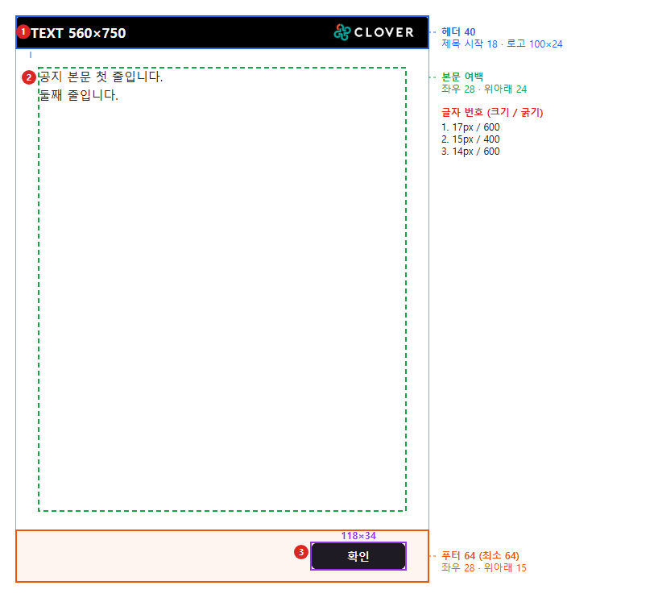
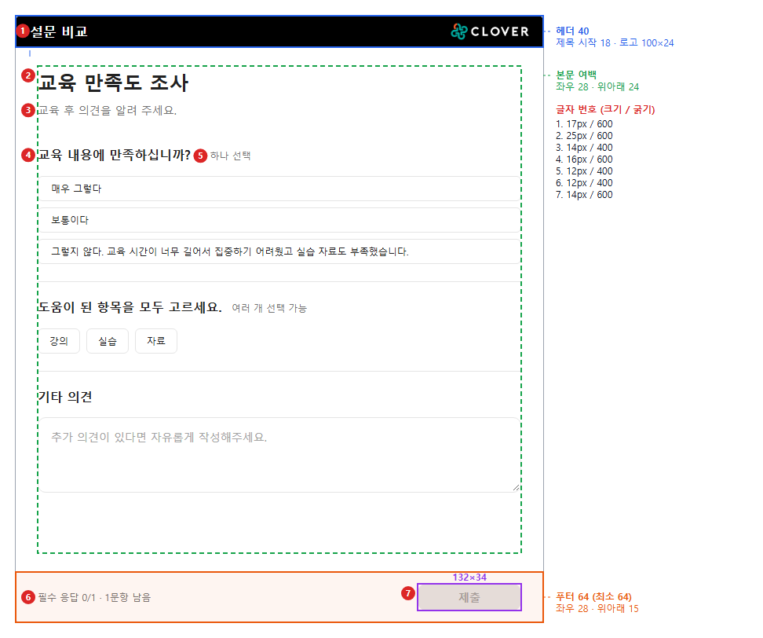
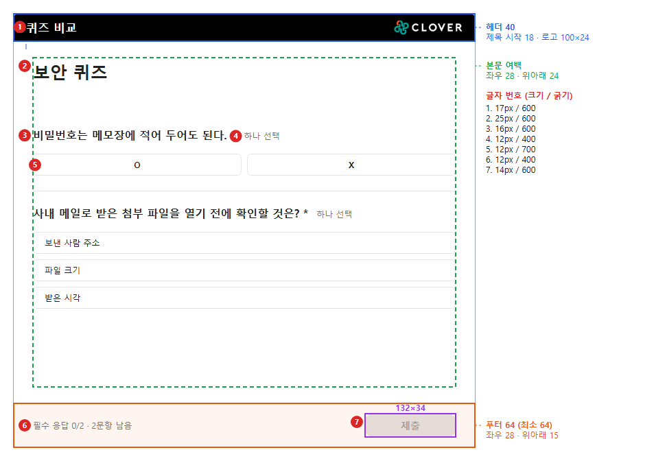
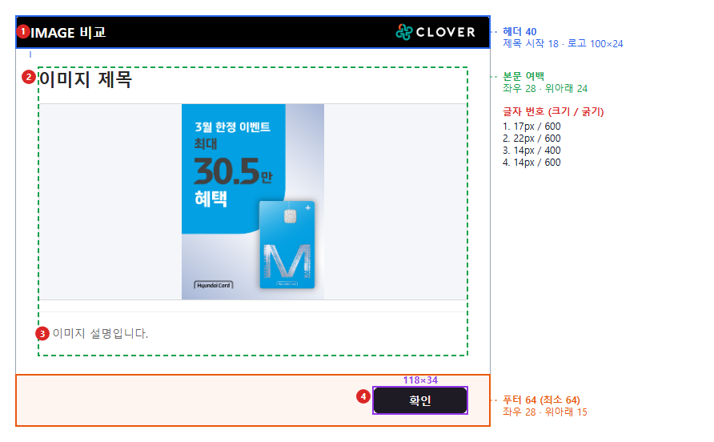

# 팝업 레이아웃 가이드

기준 형상 · `main` `b4632d8` 이후 작업 트리 (2026-11-19 KST)  
범위 · 관리자 웹 미리보기(`PopupPreview`)와 WPF 실제 팝업(`PopupWindow`)의 공통 창 구조·여백·버튼·글자 크기  
관련 · [팝업 UI 기본값 사양](61_POPUP_UI_DEFAULTS_SPEC.md)(영역별 기본값 표) · [TODO61-20 실측 기록](../reviews/TODO61-20_popup_ui_parity/README.md) · [TODO61](61_관리자_미리보기_컴포넌트화_TODO.md#61-22-팝업-레이아웃-가이드-2026-11-19)

그림은 웹 미리보기 흰 판(그림자 여백을 뺀 내부 패널)을 브라우저 100%로 캡처하고, 그 위에 영역과 수치를 표시한 것이다. 수치는 웹 CSS px와 WPF DIP가 같다(Windows 96 DPI 기준). 번호표의 WPF 값은 같은 데이터로 띄운 실제 WPF 팝업에서 잰 값이다.

| 색 | 표시 |
|---|---|
| 파랑 | 헤더 |
| 초록 점선 | 본문 콘텐츠 영역(본문 여백 안쪽) |
| 주황 | 푸터 |
| 보라 | 푸터 버튼(크기 표시) |
| 빨강 번호 | 글자 크기/굵기가 처음 나오는 요소 |

## 다시 만들기

```
node scripts/verify-popup-parity.cjs
```

- 결과는 `.offline-verify/popup-parity/`에 생긴다. `<ID>.guide.png`(이 문서의 그림), `<ID>.side.png`(웹·WPF 나란히), `guide-figures.md`(유형별 그림·번호표), `texts.md`(전체 글자 대조)다.
- 레이아웃을 바꾼 뒤 다시 실행해 아래 그림을 `61_popup_layout_guide/`에 덮어쓰고, 유형별 절은 `guide-figures.md` 내용으로 바꾼다.
- 한계: 로그인한 관리자 화면이 아닌 같은 컴포넌트 하네스다. 브라우저 확대·Windows 배율·폐쇄망 전역 CSS는 포함하지 않는다. WPF 영상(WebView2)은 캡처에 그려지지 않는다.

## 공통 창 구조



| 영역 | 값 | 웹(관리자 미리보기) | WPF |
|---|---|---|---|
| 창 바깥 그림자 여백 | 24 (영상 창·FULLSCREEN 0) | `POPUP_LAYOUT.windowMargin`, `previewShadowMargin()` | `PopupOuterGrid` Margin 24 |
| 헤더 | 높이 40, 검정 배경 | `POPUP_LAYOUT.headerHeight` | `HeaderRow` 40, `HeaderArea` |
| 헤더 제목 | 17 / 600, 왼쪽 시작 18, 한 줄 말줄임 | `POPUP_DEFAULT_FONT_SIZES.header`, `POPUP_LAYOUT.headerPaddingLeft` | `PopupTitleText` |
| 헤더 로고 | 100×24, 오른쪽 끝 | `PopupPreview` 헤더 로고 | `HeaderLogo` |
| 본문 여백 | 좌우 28 · 위아래 24 | `POPUP_LAYOUT.contentPaddingX/Y` | `PopupContent` Margin 28,24,28,24 |
| 푸터 | 최소 높이 64, 좌우 28 · 위아래 15, 구분선 없음 | `POPUP_LAYOUT.footerHeight/footerPaddingX/footerPaddingY`, `PopupFooter` | `FooterRow`(최소 64), `FooterArea` Margin 28,15,28,15 |
| 푸터 간격 | 나중에 보기 → 안내 16, 버튼 사이 10 | `POPUP_LAYOUT.footerGroupGap/footerButtonGap` | `FooterLaterButton`·안내 Margin 오른쪽 16, `FooterAuxCloseButton` 10 |
| 확인·바로가기 버튼 | 최소 118 × 34, 좌우 22, 모서리 9, #111827 · 흰 글자 14/600 | `PopupFooterButton kind="primary"` | `FooterActionButtonStyle` |
| 나중에 보기·보조 닫기 | 최소 118 × 34, 밝은 면 #F3F4F6 · 테두리 #D1D5DB | `kind="secondary"` | `FooterSecondaryButtonStyle` |
| 제출 | 최소 132 × 34, 모서리 11, 설문 버튼 색 | `kind="submit"` | `SurveyFooterSubmitButtonStyle` |
| 푸터 글자 | 버튼·체크박스 14(`footerFontSize` 우선), 설문 응답 진행 문구 12 고정 | `PopupFooter` `fontSize` | `ApplyFontSizes`, `FooterResponseProgressText` |
| TEXT 본문 | 15 / 400 (`bodyFontSize` 우선) | `POPUP_DEFAULT_FONT_SIZES.textBody` | `BodyTextStyle` |

웹 수치·색 원본은 `zero-rule-web/main/src/features/PopupcommonComponent/popupLayout.ts`, 푸터는 `PopupFooter.tsx`다. WPF 푸터 버튼 스타일은 `popup-frameWork/Popup/Views/Windows/PopupStyles.xaml`, 설문 제출은 `Views/Contents/SurveyDesigns/SurveyStyles.V1·V2.xaml`에 있다. 결과 안내창 버튼(`ActionButtonStyle`, 높이 44)은 푸터 버튼과 별개다.

## 푸터 배치 규칙

- 순서: 왼쪽 끝 **나중에 보기** → **안내 문구·다시 보지 않기** → 오른쪽 **보조 닫기·확인/바로가기/제출**. WPF `FooterArea`의 세 열과 같다.
- 버튼 아래~흰 판 아래는 15다(모든 유형 실측 일치).
- 좁은 폭에서 웹 일반 푸터는 오른쪽 버튼 묶음을 다음 줄로 내리고 푸터가 위로 늘어난다(아래 TEXT 좁은 폭 그림, 푸터 110). WPF는 줄을 나누지 않는다. 설문 푸터는 줄을 나누지 않고 안내 문구를 줄바꿈한다.
- 다시 보지 않기 글자 위치는 웹·WPF가 같다(MUI `FormControlLabel` 기본 여백을 푸터 안에서 0으로 둔다).

## 유형별

번호표의 `—`는 같은 글자를 자동으로 짝짓지 못한 경우다. 문항 제목은 웹이 제목과 '하나 선택' 안내를 한 요소로 그려 글자가 달라지지만, WPF 문항 제목도 16/600이다([실측 표](../reviews/TODO61-20_popup_ui_parity/MEASURES_61-21.md)). 영상 컨트롤 줄(▶ 00:00)은 미리보기 전용이다.

### TEXT (560×750)

샘플 ID `PARITY-TEXT-560x750`


| 번호 | 글자 | 웹 크기/굵기 | WPF 크기/굵기 |
|---|---|---|---|
| 1 | TEXT 560×750 | 17/600 | 17/600 |
| 2 | 공지 본문 첫 줄입니다. 둘째 줄입니다. | 15/400 | 15/400 |
| 3 | 확인 | 14/600 | 14/600 |

웹·WPF 나란히: [PARITY-TEXT-560x750.side.png](61_popup_layout_guide/PARITY-TEXT-560x750.side.png)

### TEXT 좁은 폭·긴 문구·나중에 보기·다시 보지 않기 (360×480)

샘플 ID `PARITY-TEXT-NARROW-LONG`


| 번호 | 글자 | 웹 크기/굵기 | WPF 크기/굵기 |
|---|---|---|---|
| 1 | 좁은 폭에서 아주 긴 팝업 제목이 한 줄 말 | 17/600 | 17/600 |
| 2 | 긴 문구 줄바꿈 확인용 본문입니다. 좁은 창 | 15/400 | 15/400 |
| 3 | 나중에 보기 | 14/600 | 14/600 |
| 4 | 30일간 보지 않기 | 14/400 | 14/400 |

웹·WPF 나란히: [PARITY-TEXT-NARROW-LONG.side.png](61_popup_layout_guide/PARITY-TEXT-NARROW-LONG.side.png)

### SURVEY (720×820)

샘플 ID `PARITY-SURVEY`



| 번호 | 글자 | 웹 크기/굵기 | WPF 크기/굵기 |
|---|---|---|---|
| 1 | 설문 비교 | 17/600 | 17/600 |
| 2 | 교육 만족도 조사 | 25/600 | 25/600 |
| 3 | 교육 후 의견을 알려 주세요. | 14/400 | 14/400 |
| 4 | 교육 내용에 만족하십니까? *하나 선택 | 16/600 | — |
| 5 | 하나 선택 | 12/400 | 12/400 |
| 6 | 필수 응답 0/1 · 1문항 남음 | 12/400 | 12/400 |
| 7 | 제출 | 14/600 | 14/600 |

웹·WPF 나란히: [PARITY-SURVEY.side.png](61_popup_layout_guide/PARITY-SURVEY.side.png)

### QUIZ — OX·선다형 (720×680)

샘플 ID `PARITY-QUIZ-OX`



| 번호 | 글자 | 웹 크기/굵기 | WPF 크기/굵기 |
|---|---|---|---|
| 1 | 퀴즈 비교 | 17/600 | 17/600 |
| 2 | 보안 퀴즈 | 25/600 | 25/600 |
| 3 | 비밀번호는 메모장에 적어 두어도 된다. *하 | 16/600 | — |
| 4 | 하나 선택 | 12/400 | 12/400 |
| 5 | O | 12/700 | 12/700 |
| 6 | 필수 응답 0/2 · 2문항 남음 | 12/400 | 12/400 |
| 7 | 제출 | 14/600 | 14/600 |

웹·WPF 나란히: [PARITY-QUIZ-OX.side.png](61_popup_layout_guide/PARITY-QUIZ-OX.side.png)

### IMAGE — ADAPTIVE (640×560)

샘플 ID `PARITY-IMAGE`



| 번호 | 글자 | 웹 크기/굵기 | WPF 크기/굵기 |
|---|---|---|---|
| 1 | IMAGE 비교 | 17/600 | 17/600 |
| 2 | 이미지 제목 | 22/600 | 22/600 |
| 3 | 이미지 설명입니다. | 14/400 | 14/400 |
| 4 | 확인 | 14/600 | 14/600 |

웹·WPF 나란히: [PARITY-IMAGE.side.png](61_popup_layout_guide/PARITY-IMAGE.side.png)

### VIDEO (720×640)

샘플 ID `PARITY-VIDEO`


| 번호 | 글자 | 웹 크기/굵기 | WPF 크기/굵기 |
|---|---|---|---|
| 1 | VIDEO 비교 | 17/600 | 17/600 |
| 2 | 영상 제목 | 22/600 | 22/600 |
| 3 | ▶ 00:00 / 00:00 | 14/400 | — |
| 4 | 확인 | 14/600 | 14/600 |

웹·WPF 나란히: [PARITY-VIDEO.side.png](61_popup_layout_guide/PARITY-VIDEO.side.png)

### VIDEO+QUIZ (720×900)

샘플 ID `PARITY-VIDEO-QUIZ`


| 번호 | 글자 | 웹 크기/굵기 | WPF 크기/굵기 |
|---|---|---|---|
| 1 | VIDEO+QUIZ 비교 | 17/600 | 17/600 |
| 2 | 영상 퀴즈 | 25/600 | 22/600 |
| 3 | ▶ 00:00 / 00:00 | 12/400 | — |
| 4 | 영상을 보고 답하세요. | 14/400 | 14/400 |
| 5 | 영상에서 확인한 내용은? *하나 선택 | 16/600 | — |
| 6 | 필수 응답 0/1 · 1문항 남음 | 12/400 | — |
| 7 | 제출 | 14/600 | 14/600 |

웹·WPF 나란히: [PARITY-VIDEO-QUIZ.side.png](61_popup_layout_guide/PARITY-VIDEO-QUIZ.side.png)

## 알려진 차이

| 항목 | 웹 | WPF | 상태 |
|---|---|---|---|
| VIDEO+QUIZ 상단 제목 | 퀴즈 제목(25/600)을 상단에 한 번 | 영상 제목(22/600), 같은 퀴즈 제목은 접음 | 기존 기록([비교 문서](../reviews/POPUP_PREVIEW_WPF_PARITY.md)) |
| VIDEO+QUIZ 푸터 문구 | 응답 진행 문구 | 시청 완료 전에는 시청 진행 문구 | 미리보기는 시청 잠금을 시연하지 않음 |
| 좁은 폭 푸터 | 버튼을 다음 줄로 | 한 줄 유지 | TODO61-18 결정(잘림 방지) |
| IMAGE 이미지·설명 상자 | 회색 테두리 | 연한 배경 | 치수는 같음 |
| 영상 영역 높이(VIDEO+QUIZ) | 실제 영상 비율 | 캡처 시점에는 메타데이터 전 16:9 | 캡처 한계(실제 재생 시 같은 계산식) |

## 레이아웃을 바꿀 때

1. 웹 `popupLayout.ts`(`POPUP_LAYOUT`·`POPUP_COLORS`)와 WPF XAML·스타일을 같은 변경 단위로 고친다. 버튼은 `PopupFooterButton`과 `Footer*ButtonStyle`을 함께 바꾼다.
2. `node scripts/verify-popup-parity.cjs`로 판정(헤더·버튼·버튼 아래 간격·본문 글자)과 `texts.md` 차이를 확인한다.
3. 이 문서의 그림·번호표와 [팝업 UI 기본값 사양](61_POPUP_UI_DEFAULTS_SPEC.md)의 수치를 갱신한다.
