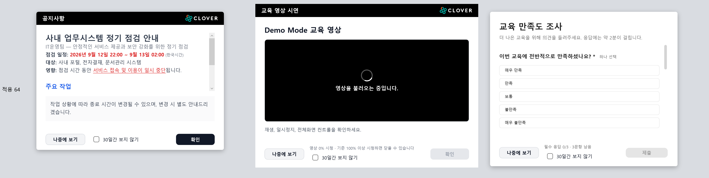
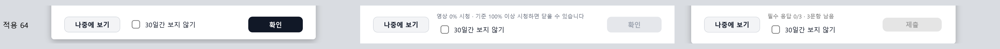

# 팝업 UI 기본값 사양

기준 형상 · `main` `1da9277` (2026-11-19 KST)  
범위 · WPF 실제 팝업, 관리자 웹 인라인·실제 크기 미리보기, 등록 화면의 공통 콘텐츠 편집기  
관련 작업 · [TODO61-20](61_관리자_미리보기_컴포넌트화_TODO.md#61-20-팝업-ui-기본값-캡처-및-회귀-검증)

표의 치수는 웹 **CSS px**, WPF **DIP** 기준이다. 여백은 상하·좌우 순서로 적었다. 창 외곽, 그림자 여백을 뺀 내부 패널, 영역 박스, 버튼·입력 자체를 각각 측정한다. 브라우저 확대나 Windows 배율이 적용된 캡처의 물리 픽셀은 배율과 함께 기록한다.

## 화면에서 확인할 위치

**그림 1.** 2026-11-18 WPF `PopupWindow` Demo 캡처. 왼쪽 공지, 가운데 영상, 오른쪽 설문이다. 위 검은 띠는 **헤더**, 가운데는 **콘텐츠**, 아래 버튼이 있는 줄은 **푸터**다. 설문에서 필수 응답이 비어 있으면 제출 버튼이 비활성화된다. 96 DPI 기준 2배 해상도로 저장된 이미지다. [캡처 원본 설명](../reviews/TODO61-18_footer_button_size/README.md)

**그림 2.** 그림 1의 푸터 확대. 버튼 높이 34, 한 줄 푸터 높이 64의 적용 사례다. 영상의 진행 문구나 설문의 응답 안내가 줄바꿈되면 푸터 높이와 버튼 하단 간격을 별도로 기록한다. 두 그림은 당시 WPF 화면 근거다. 최신 관리자 웹·폐쇄망 비교 캡처와 글꼴 실측은 TODO61-20에서 채운다.

## 공통 영역

| 영역 | 기본 글자 크기·굵기 | 기본 크기·여백 | 적용 조건 |
|---|---|---|---|
| 창·내부 패널 | — | 일반 창은 그림자 공간 사방 24. 영상 창은 그림자 없이 창 자체를 사방 24 줄여 같은 판 크기·자리(2026-11-24). FULLSCREEN은 0. 창 크기 하한은 너비·높이 각각 300을 기본으로 사용 | 웹 FIXED 미지정 입력·모달 기준 560×420. WPF `PopupOptions` 객체 초기값은 900×620. 실표시는 전달 크기·크기 모드·가용 화면 및 제한값으로 계산 |
| 헤더 제목 | **17 / SemiBold(600)** | 행 높이 **40**, 제목 시작 18, 로고와 제목 사이 12 기준. 우측 로고 **100×24**, 끝 여백 18 기준 | `headerFontSize` 지정 우선. 한 줄 말줄임. 헤더를 끄면 행도 접힘 |
| 일반 본문 외곽 | 유형별 아래 표 | 좌우 **28**, 상하 **24**. 웹은 콘텐츠 박스의 padding, WPF는 `PopupContent` margin | 이미지 모드·전체 채움처럼 여백을 별도로 처리하는 경로는 유형별 확인 |
| 공통 푸터 | 버튼·체크박스 **14** 기본, 진행·상태 문구는 별도 크기(설문 응답 진행 문구 12, 푸터 글자 크기 미적용) | 한 줄 기준 **64**, 좌우 **28**·상하 **15**가 공통 기준. 웹 일반 분기는 좌우 28px, 설문 분기는 테마 간격 `px: 3`으로 선언 | **TODO61-18**에서 분기별 실제 간격과 줄바꿈 정렬 검증. WPF 영상·설문 계열 행은 자동 높이·최소 64. 숨김 시 행을 접음 |
| 푸터 버튼 | **14** 기본, 주 버튼 SemiBold | 높이 **34**, 일반 버튼 최소 너비 **118**, 제출 최소 **132**. 일반 버튼 좌우 패딩 22·상하 0, 주 버튼 모서리 9 | `footerFontSize`가 적용되는 요소와 별도 크기의 진행 문구를 구분. WPF 결과 안내창의 버튼은 별도 스타일(높이 44) |

웹 소스 · [PopupPreview](../../zero-rule-web/main/src/features/PopupcommonComponent/PopupPreview.tsx) · [크기 상수](../../zero-rule-web/main/src/features/PopupcommonComponent/imagePreviewLayout.ts) · [모달 크기 계산](../../zero-rule-web/main/src/features/PopupcommonComponent/popupPreviewDialogLayout.ts)  
WPF 소스 · [PopupWindow.xaml](../../popup-frameWork/Popup/Views/Windows/PopupWindow.xaml) · [PopupWindow.xaml.cs](../../popup-frameWork/Popup/Views/Windows/PopupWindow.xaml.cs) · [PopupOptions](../../popup-frameWork/Popup/Models/PopupOptions.cs)

## 최소·최대 크기 요약 (2026-11-23 코드 대조)

유형별 **FIXED/RATIO/AUTO/FULLSCREEN의 창 최대값**, 콘텐츠 영역의 개별 하한·상한, WEB 미리보기와 WPF 차이의 상세 표는 [61 팝업 레이아웃 가이드 — 최소·최대 크기](61_POPUP_LAYOUT_GUIDE.md#최소최대-크기--전체-레이아웃-2026-11-23-정적-코드-확인)를 따른다. 이 절은 형상 정적 대조이며 폐쇄망·새 실화면 실측은 아니다.

| 유형 | 창 최소·최대 기본 규칙 | 별도 내부 min/max |
|---|---|---|
| TEXT | 공통 최소 300×300; 비IMAGE 창 모드별 최대 | WPF TEXT 루트 자체 최소 없음(창 최소 300을 따르고 본문은 스크롤, 2026-11-23 320×240 제거) |
| IMAGE | 공통 최소 300×300; 일반 모드 작업 영역 최대 90% | 원본 초과 확대 없음(ADAPTIVE), 설명 높이 최대 관련 영역 30% |
| VIDEO | 공통 최소 300×300; 비IMAGE 창 모드별 최대 | WPF 영상 행 가변. WEB 단독 영상 미리보기 영역 최소 높이 170 |
| SURVEY | 공통 최소 300×300; 비IMAGE 창 모드별 최대 | 콘텐츠 최대 너비 760, 선택지 최소 높이 32, 주관식 높이 96~180(내용에 맞춰 커지고 넘치면 스크롤, 끌어서 늘이지 않음 — 웹 `POPUP_LAYOUT.textAnswer`·WPF `SurveyPopupView.TextAnswerMinHeight/MaxHeight`, 2026-11-25) |
| QUIZ | SURVEY와 동일 | SURVEY와 동일 |
| VIDEO+QUIZ | 비IMAGE 창 크기 모드 적용 | 퀴즈 너비 최대 760, 영상 높이 최소 180·부모 스크롤 높이 70% 상한(최소보다 작으면 180 우선) |

- 비IMAGE WPF 창 최대: **FIXED** 설정 maximum과 작업 영역 90% 중 작은 값(2026-11-24 95%에서 통일) / **RATIO** 설정 maximum과 작업 영역 90% 중 작은 값(2026-11-25 100%에서 통일) / **AUTO** 설정 maximum과 작업 영역 90% 중 작은 값. **FULLSCREEN**은 별도 화면 크기 적용.
- IMAGE도 비전체화면 모드에서 다른 유형과 같이 설정 maximum과 작업 영역 **90%** 중 작은 값(2026-11-25, 이전에는 설정 maximum 미사용). WEB 실제 크기 모달은 WPF와 같이 작업 영역(기준 화면 해상도 × 배율 프리셋, DIP) 기준 FIXED·IMAGE **90%**, RATIO **100%** 상한이며 브라우저 표시 영역을 넘는 축만 줄인다(TODO61-23). 인라인은 미리보기 칸 **최소 높이 320**.
- 기본 `maximumWidth=1200`·`maximumHeight=900`은 **설정값의 기본**이지 모든 창에 적용되는 절대 최대 픽셀값이 아니다.

## 유형별 본문과 등록 입력

| 영역 | 기본 글자 크기 | 크기·여백과 동작 |
|---|---:|---|
| TEXT 본문 | **15** | 공통 본문 여백 사용. 긴 문장과 서식 문단의 줄바꿈·세로 스크롤 확인. 명시된 Run 크기·글꼴과 문단 들여쓰기를 재현 |
| IMAGE·VIDEO 콘텐츠 제목 | **22 / 600** | 표시 조건을 충족할 때만 제목 표시. VIDEO는 제목 아래 15. IMAGE는 크기 모드와 설명 표시 여부별로 이미지 영역·패널 여백 확인 |
| IMAGE·VIDEO 설명 | **14** | VIDEO는 영상 다음에 설명이 온다. 미디어 크기와 설명 영역은 분리해 측정 |
| VIDEO 재생 영역 | — | 단독 VIDEO는 남은 높이를 사용하고 영상 비율을 유지한다. VIDEO+QUIZ는 영상 폭·원본 비율로 높이를 산정한다. 영상 테두리 1·모서리 8 기준. 미첨부·실패, 멀티라인 설명·높이 600 부근 스크롤 검증 |
| SURVEY·QUIZ 콘텐츠 제목·설명 | **25 / 14** (제목 굵기 600) | 웹 제목 위 4, 설명 줄 높이 22·아래 14. VIDEO+QUIZ의 중복 설명 접힘 조건은 별도 확인 |
| SURVEY·QUIZ 문항 제목·설명 | **16 / 13** | 본문 크기 명시 시 각각 `bodyFontSize + 4`, `bodyFontSize + 1`. 문항 간 간격과 서식으로 지정한 글자 크기도 확인 |
| 응답 선택지·OX | **12**, 기본 줄 높이 **18** | 한 줄 최소 **32**(테두리 1씩 + 상하 패딩 6씩 + 줄 18). 웹 가로형 좌우 14·세로형 좌우 16. 긴 선택지는 높이 증가. 글자 크기는 `(bodyFontSize ?? 14) - 2`, 줄 높이는 글자 크기 × 1.5 기준 |
| 주관식 응답 | **14** | `bodyFontSize`가 있으면 적용. 높이는 96~180 자동(웹·WPF 같음). 입력 박스·안내 문구와 실제 WPF 입력 영역을 구분해 실측 |
| 등록 화면 일반 선택지 입력 | **12**, 줄 높이 **18** | `PopupQuestionEditor`의 의도는 한 줄 외곽 **32**(상하 7씩 + 줄 18), 좌우 패딩 10. DevTools에서 textarea line-height·실제 높이와 `MuiInputBase`의 padding·외곽 높이를 각각 확인 |
| 등록 화면 CKEditor | 선택지 **12**, 문항 제목 **16**, compact 설명 기본 **14**, 일반 본문 기본 **15** | 선택지 모드 안쪽 최소 30 + 테두리 2. 다른 compact 기본 안쪽 최소 34, 일반 편집 영역 최소 140. 호출부 `baseFontSize`와 서식 지정값 적용. 편집 상자의 높이와 출력 글자 줄 높이는 각각 확인 |

구현 근거 · [웹 유형별 렌더러](../../zero-rule-web/main/src/features/PopupcommonComponent/PopupPreview.tsx) · [SurveyPreview](../../zero-rule-web/main/src/features/PopupcommonComponent/SurveyPreview.tsx) · [PopupQuestionEditor](../../zero-rule-web/main/src/features/PopupcommonComponent/PopupQuestionEditor.tsx) · [PopupRichTextEditor](../../zero-rule-web/main/src/features/PopupcommonComponent/PopupRichTextEditor.tsx) · [WPF 콘텐츠 View](../../popup-frameWork/Popup/Views/Contents)

## 글꼴 패밀리와 적용 순서

| 적용 범위 | 웹 선언 | WPF 선언 | 화면 검증 |
|---|---|---|---|
| 헤더·본문·문항·선택지·푸터·편집기의 일반 글자 | 화면 또는 편집기 스타일에 별도 family가 없으면 테마·상위 CSS 또는 해당 컨트롤을 따름. 프로토타입 `typography.ts`의 공통 `fontFamily` 예시는 주석 상태 | 공통 `PopupWindow`에 표시 텍스트의 family를 일괄 지정하지 않음. 해당 컨트롤과 상속·시스템 글꼴을 따름 | 한글·영문·숫자별로 웹 DevTools의 Computed `font-family`와 Rendered Fonts, WPF 요소의 유효 `FontFamily` 및 대체 글리프를 확인. 폐쇄망에 반입된 테마의 값은 별도 기록 |
| 서식을 지정한 텍스트 구간 | 저장값 `Malgun Gothic` → 맑은 고딕/Malgun Gothic/sans-serif, `Gulim` → 굴림/Gulim/sans-serif, `Dotum` → 돋움/Dotum/sans-serif, `Batang` → 바탕/Batang/serif(2026-11-24 글꼴 ID 삭제) | 같은 ID를 Malgun Gothic·Gulim·Dotum·Batang으로 매핑. 미설치 글꼴은 시스템 대체 표시 | 기본/명시 값을 나란히 비교하고 브라우저·WPF에서 같은 한글과 영문 샘플을 확인 |
| 아이콘·영상 컨트롤 | 웹 렌더러의 SVG·아이콘 구성 | WPF 재생 아이콘 일부에 Segoe Fluent Icons·Segoe UI Symbol 명시 | 일반 글자와 분리해 아이콘 잘림·대체 여부 확인 |

폰트 크기 적용은 **해당 옵션을 지원하는 요소에서** 영역 기본값 → 유효한 영역 지정값(웹·WPF 10~40 보정) → 해당 구간에 지정된 서식 값 순이다. 설문·퀴즈는 표의 파생 규칙을 적용한다. 폐쇄망에서 전역 CSS가 이 의도에 간섭하는 사례는 TODO61-19에서 확인한다. 공통 family를 새로 고정하거나 기존 저장 데이터에 기본값을 채우는 변경은 이 사양에서 확정하지 않는다.

근거 · [웹 폰트 기본값](../../zero-rule-web/main/src/features/PopupcommonComponent/popupCommon.ts) · [웹 테마](../../zero-rule-web/main/src/theme/typography.ts) · [서식 ID와 CSS 매핑](../../zero-rule-web/main/src/features/PopupcommonComponent/popupRichText.ts) · [WPF Run 매핑](../../popup-frameWork/Popup/Views/Contents/PopupRichText.cs)

## 실측 기록

영역 표시가 들어간 유형별 캡처와 웹 상수·WPF 선언 대응표는 [팝업 레이아웃 가이드](61_POPUP_LAYOUT_GUIDE.md)에 있다.

2026-11-19 로컬 하네스 실측(웹 100%·WPF 96 DPI, 11세트): [TODO61-20 결과](../reviews/TODO61-20_popup_ui_parity/README.md). 헤더 40·제목 17/600, 주 버튼 118×34·제출 132×34, 버튼 아래 15, TEXT 본문 15는 웹·WPF가 같다. 그때 나온 두 차이(설문 제목 굵기, 설문 푸터 진행 문구)는 TODO61-21에서 WPF 기준으로 맞췄다. 웹 수치는 `popupLayout.ts`(`POPUP_LAYOUT`·`POPUP_COLORS`)와 `PopupFooter.tsx`, WPF 푸터 버튼은 `FooterActionButtonStyle`·`FooterSecondaryButtonStyle`·`SurveyFooterSubmitButtonStyle`에 모여 있다.

## 캡처와 검증 기록 규칙

| 비교 세트 | 동일 데이터로 남길 화면·실측 |
|---|---|
| TEXT 560×750 | 관리자 인라인·실제 크기 모달·WPF. 창 외곽, 패널, 헤더·본문·푸터 박스, 실제 버튼 아래 간격. `pb: 0` 관찰은 TODO61-18에 연결 |
| SURVEY·QUIZ | 관리자 편집기(일반·서식 옵션), 인라인·모달·WPF. 기본 한 줄·긴 선택지·OX·주관식·필수 문구를 넣어 글자·패딩·외곽 높이를 측정 |
| IMAGE·VIDEO·VIDEO+QUIZ | 미첨부 및 일반 첨부. 제목·설명 표시 여부와 영상 영역·이미지 모드별 여백, 스크롤·헤더/푸터 숨김 비교 |
| 글꼴 비교 | 지정값 없음·헤더/본문/푸터 지정·Run 지정 각각 캡처. 실제 글꼴, 크기, 테마/전역 스타일 출처와 웹 확대·Windows DPI를 함께 기록 |

기록에는 커밋·반입본 버전, 동일 샘플 ID, 팝업 유형·지정 크기, 브라우저 확대와 Windows 배율을 넣는다. [기존 비교 하네스 설명](../reviews/POPUP_PREVIEW_WPF_PARITY.md)을 참고해 prototype 하네스·관리자 로그인 화면·폐쇄망·WPF 실화면 결과를 구분한다. 수치 차이는 영역, 두 값, 스타일 적용 위치와 증거 파일을 함께 남긴다.
