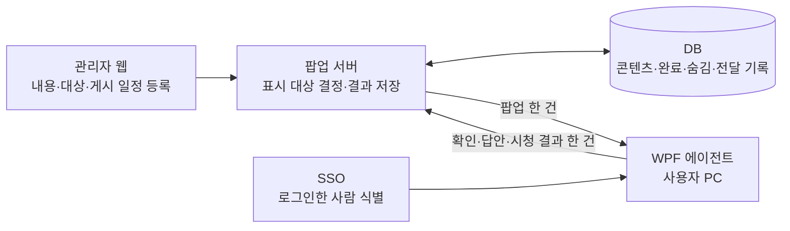
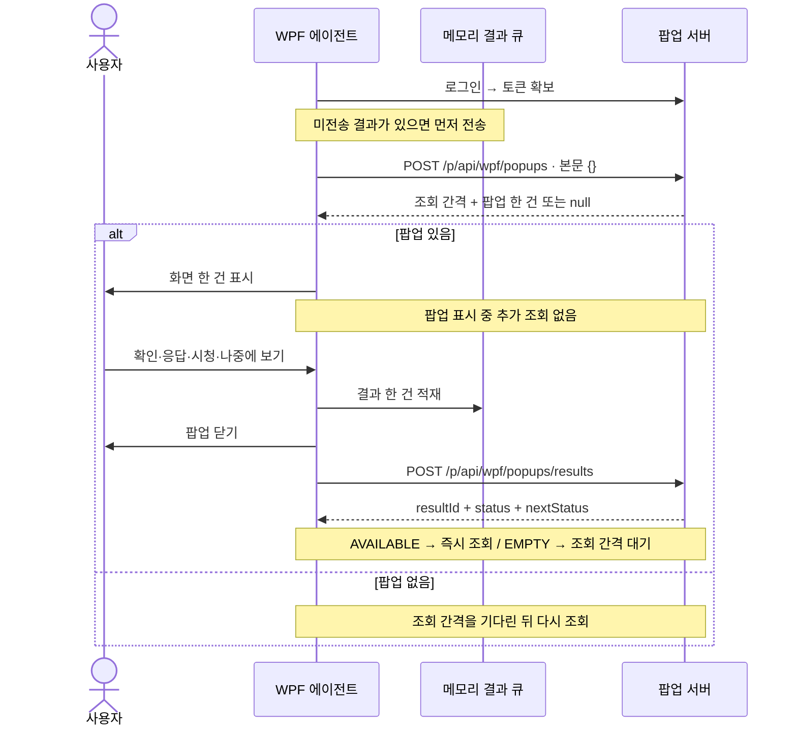
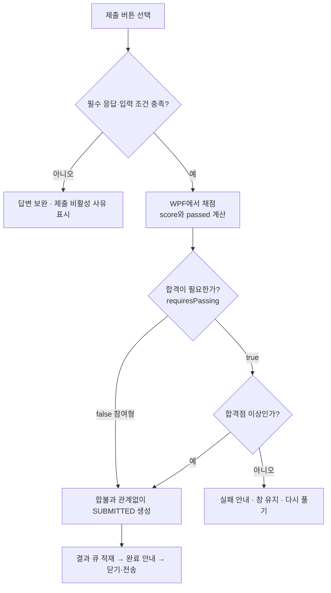
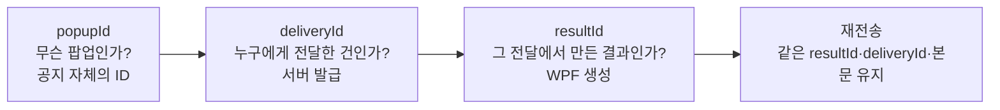
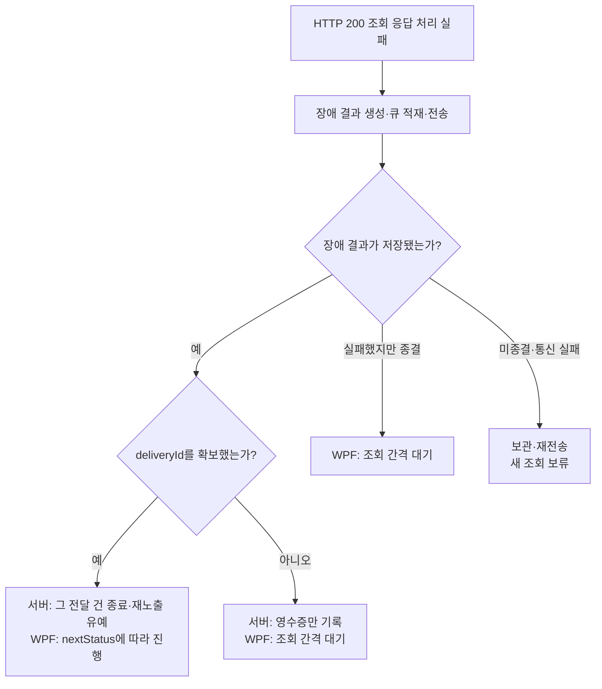
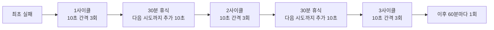

# WPF 에이전트 통합 사양서

**Windows PC에서 팝업을 받아 보여 주고, 확인·응답·시청 결과를 서버에 보내는 프로그램의 사양서입니다.**

| 구분 | 내용 |
|---|---|
| 문서 버전 | 1.0 |
| 작성 기준일 | 2026-11-11 (한국 시간, KST) |
| 대상 | WPF 팝업 에이전트와 에이전트가 사용하는 서버 API |
| 구성 | 동작 정책 + 화면 설명 + HTTP·JSON 인터페이스 + 예제 + 확인 기준 |
| 기능 범위 | 현재 전체 구현 기능([전체 기능 정의서](WPF_POPUP_ALL_SPEC.md)). 최소 기능 정의서는 2026-11-11 삭제 |
| 작성 근거 | [통합 정책](../../policies/POLICY.md), [인터페이스 v3.7](POPUP_INTERFACE_SPEC.md), [전체 기능 정의서](WPF_POPUP_ALL_SPEC.md), 관련 구현 |

이 문서는 정책과 인터페이스를 기능별로 엮어 설명합니다. 예를 들어 ‘나중에 보기’를 읽으면 버튼을 언제 보여 주는지, 어떤 JSON을 보내는지, 언제 다시 표시되는지를 함께 알 수 있습니다. 기존 계약의 이름·값·기능 범위를 바꾸지는 않습니다.

**표 읽는 방법:** ‘필수’는 서버가 반드시 제공해야 하는 값입니다. ‘선택’은 생략하면 설명한 기본값을 쓰는 값입니다. ‘조건부’는 해당 기능을 사용할 때 필요한 값입니다. 생략과 `null`은 다릅니다. `null` 허용을 적지 않은 항목에는 임의로 `null`을 보내지 않습니다.

## 읽는 순서

| 알고 싶은 내용 | 읽을 곳 |
|---|---|
| 프로그램이 무엇을 하는가 | [1. 구성과 역할](#overview) → [2. 전체 흐름](#lifecycle) |
| 서버와 어떻게 통신하는가 | [3. 인증과 API](#api) → [4. 조회 데이터](#query) |
| 화면과 버튼이 어떻게 동작하는가 | [5. 공통 화면](#window) → [6. 유형별 기능](#contents) |
| 닫기·완료·숨김은 어떻게 다른가 | [7. 결과 생성과 완료](#results) |
| 전송 실패나 잘못된 데이터는 어떻게 처리하는가 | [8. 결과 응답](#response) → [9. 장애 결과](#error-result) → [10. 복구](#recovery) |
| 실행 설정과 검증 범위를 확인하고 싶다 | [11. 실행과 설정](#runtime) → [12. 확인 항목](#verification) |
| 원본 정책·계약을 찾아야 한다 | [13. 근거 문서](#references) |

<a id="overview"></a>

## 1. 구성과 역할

### 1.1 에이전트가 하는 일

에이전트는 PC에서 백그라운드로 실행합니다. 로그인한 사람에게 보여 줄 팝업이 있는지 서버에 물어보고, 서버가 내려 준 팝업 **한 건**을 화면에 표시합니다. 사람이 확인하거나 답변하면 그 결과를 서버에 보냅니다.



관리자 웹은 팝업을 작성하는 곳이고, 에이전트는 작성된 팝업을 보여 주는 곳입니다. 서버는 둘 사이에서 데이터를 전달하고 표시할 대상을 결정합니다.

### 1.2 누가 무엇을 결정하는가

| 주체 | 맡는 일 | 예시 |
|---|---|---|
| 관리자 웹 | 내용·문항·대상·게시 일정 편집 | 교육 영상을 등록하고 대상 부서를 지정 |
| 서버 | 표시 자격·순서 결정, 전달 건 관리, 결과 검증·저장 | 이미 완료한 교육을 조회 대상에서 제외 |
| WPF 에이전트 | 화면 표시, 입력 확인, 퀴즈 채점, 시청 시간 측정, 결과 전송 | 필수 답변이 비면 제출 버튼 비활성 |
| SSO·인증 연동 | 사용자 식별과 인증 정보 제공 | 사번·분류 코드 확보 후 토큰으로 API 호출 |

게시 기간, 대상, 완료, 숨김, 재노출 유예, 요일·시간대는 서버가 판단합니다. 에이전트가 PC 시각으로 게시 여부를 다시 판정하거나 다음 팝업을 미리 골라 두지는 않습니다.

퀴즈 채점은 에이전트가 맡습니다. 서버는 답안의 문항·선택지 소속과 필수 응답 등을 검증하지만, 답안을 다시 채점하지 않고 전달받은 점수·합불을 저장합니다.

### 1.3 먼저 알아 둘 용어

| 용어 | 쉬운 설명 |
|---|---|
| 팝업 | 화면에 표시할 공지·이미지·영상·설문·퀴즈 한 건 |
| 전달 건 | 서버가 특정 사용자에게 특정 팝업을 내려 준 기록 |
| 결과 | 그 전달 건에서 확인·숨김·응답·시청 등으로 끝난 내용 |
| 조회 간격 | 당장 표시할 대상이 없을 때 다시 물어보기까지 기다리는 시간 |
| 결과 큐 | 아직 전송이 끝나지 않은 결과를 순서대로 담아 두는 메모리 공간 |
| 완료 | 해당 사용자에게 그 팝업을 더 이상 표시할 필요가 없는 상태 |
| 숨김 | 지정한 일수 동안 표시에서 제외하는 상태 |
| 재노출 유예 | 미완료 팝업을 다음 조회 주기까지 잠시 제외하는 처리 |
| Overlay | 팝업 뒤를 어둡게 덮고 뒤쪽 마우스 입력을 막는 별도 배경 창 |

<a id="lifecycle"></a>

## 2. 전체 흐름

### 2.1 실행부터 다음 팝업까지



일반 실행은 기본적으로 로그인 직후 처음 조회합니다. 결과를 보내지 못해 큐에 남아 있으면 새 팝업을 받기 전에 그 결과부터 처리합니다. 자세한 예외는 [10절](#recovery)에 있습니다.

창은 결과를 메모리에 넣은 뒤 닫습니다. 따라서 **화면이 닫혔다는 사실만으로 서버 저장이 끝났다고 볼 수는 없습니다.** 통신 실패 시 같은 결과를 다시 보내는 이유입니다. 제출형 화면은 완료 안내를 보여 줄 수 있으며, 이 경우에도 결과를 먼저 큐에 넣습니다.

### 2.2 언제 다시 조회하는가

| 상황 | 다음 동작 |
|---|---|
| 조회 응답의 `popup`이 `null` | 가장 최근 조회 간격을 기다린 뒤 조회 |
| 결과 저장 성공 + `nextStatus=AVAILABLE` | 즉시 조회 |
| 결과 저장 성공 + `nextStatus=EMPTY` | 가장 최근 조회 간격을 기다린 뒤 조회 |
| 결과 저장 성공 + `nextStatus` 생략 | 즉시 조회. 다음 후보 확인 실패가 결과 저장 실패를 뜻하지는 않음 |
| 일반 결과가 `REJECTED`로 종결 | 해당 결과를 지우고 다음 조회 진행 |
| 미종결 결과가 남음 | 새 조회 보류 → 결과 재전송 |
| 장애 결과에 전달 건 ID가 없거나, 장애 결과를 저장하지 못하고 종결 | 즉시 재조회하지 않고 조회 간격 대기([9절](#error-result)) |

조회 간격은 `pollingIntervalSeconds`이며 **1,800~3,600초, 즉 30~60분**입니다. 서버의 최근 값을 우선하며 양수 범위 밖 값은 이 범위로 보정합니다. 값이 없거나 0 이하이면 로컬 설정을 유지하고, 로컬 설정도 0 이하이면 1,800초를 씁니다.

예를 들어 09:10에 대상 없음 응답을 받았고 간격이 1,800초라면 다음 조회는 약 09:40입니다. 프로그램을 켠 시각의 정각에 맞추지 않습니다. 이 방식은 정각 표시나 2분 이내 표시를 보장하지 않으며, 짧은 게시 시간대를 조회 사이에 놓칠 수 있습니다.

### 2.3 표시 순서와 반복 일정

서버는 게시 중이고 기간·대상·일정에 맞는 팝업 중 완료·숨김·유예 대상을 제외합니다. 남은 팝업을 관리자 표시 순서 → 생성 시각 → 팝업 ID 순으로 정렬해 첫 한 건을 내려 줍니다.

요일·시간대 일정은 서버가 한국 시간으로 판단합니다. 요일이 없으면 매일, 시간대가 없으면 종일이며, 자정을 넘는 시간대는 시작 요일에 속합니다. 일정은 미완료 팝업을 언제 보여 줄지 정하는 조건입니다. **한 번 완료한 팝업을 다음 반복일에 새 과제처럼 다시 내리는 기능은 아닙니다.**

결과를 저장할 때는 표시 중에 게시 시간대가 끝났다는 이유만으로 거절하지 않습니다. 전달 건의 소유자·팝업 일치 등 결과 수용 조건은 별도로 검사합니다.

<a id="api"></a>

## 3. 인증과 API

근거: [POL-09](../../policies/POL-09.md), [POL-15](../../policies/POL-15.md), [인터페이스 2~5절](POPUP_INTERFACE_SPEC.md#2-공통-httpjson-규약).

### 3.1 사용하는 API는 세 가지

| 기능 | 방식 | 기본 경로 | 주고받는 내용 |
|---|---|---|---|
| 로그인 | POST | `/p/api/wpf/auth/login` | 사용자 식별 정보 → 토큰 |
| 표시 대상 조회 | POST | `/p/api/wpf/popups` | 빈 객체 → 팝업 한 건 또는 `null` |
| 결과 전송 | POST | `/p/api/wpf/popups/results` | 결과 한 건 → 처리 상태·다음 후보 유무 |

조회도 POST입니다. 서버가 조회 과정에서 전달 건을 만들거나 기존 전달 건을 다시 사용하기 때문입니다. 목록 배열을 받는 GET API나 결과 여러 건을 한꺼번에 보내는 API는 사용하지 않습니다.

전체 주소는 `PopupApi.BaseUrl`과 위 경로를 붙여 만듭니다. 예를 들어 BaseUrl이 `https://example.company/zero-rule-server`라면 조회 주소는 `https://example.company/zero-rule-server/p/api/wpf/popups`입니다. BaseUrl은 서버 주소(컨텍스트 경로까지)이며 `/p`는 넣지 않습니다. `/p`는 서버 컨트롤러 경로의 일부라 위 경로에 포함되어 있습니다.

폐쇄망 로그인은 `Auth.LoginPath=/p/api/auth/sso/login`으로 바꿉니다. `/p/api/wpf/auth/login`은 로컬 프로토타입의 기본 로그인 경로입니다.

### 3.2 공통 통신 규칙

| 항목 | 규칙 |
|---|---|
| 데이터 | UTF-8 JSON, `Content-Type: application/json` |
| 필드명 | camelCase. 예: `popupId`, `showLater` |
| 날짜·시간 | ISO 8601 문자열. 예: `2026-11-11T09:00:00+09:00` |
| 클라이언트 버전 | `X-Client-Version` 헤더. 값은 실행 파일 버전에서 생성 |
| 인증 | 로그인 후 `Authorization: Bearer <토큰>` |
| 호출 제한 시간 | 현재 10초 |
| 사용자 식별 | 조회·결과 본문에 `userId`를 넣지 않고 서버가 인증 정보로 식별 |

### 3.3 로그인 순서와 JSON

에이전트는 SSO XML의 `MAIN_USER_ID`와 `MAIN_USER_CLASSI_CODE`에서 사용자 식별값과 분류 코드를 얻고 로그인 API에 보냅니다.

```json
{
  "lgonId": "E1001",
  "classCode": "10",
  "linkYn": "N"
}
```

`lgonId`가 현재 요청 키입니다. `linkYn`은 에이전트가 항상 `N`으로 보냅니다.

2xx 응답이면 다음 순서로 토큰을 찾습니다.

1. 응답 헤더 `x-custom-authorization`을 읽습니다. `Bearer `가 붙어 있으면 접두사를 제거합니다.
2. 헤더에 토큰이 없으면 응답 본문의 `accessToken`을 읽습니다.
3. 둘 다 없거나 비어 있으면 로그인 실패입니다. HTTP 200만으로 성공으로 보지 않습니다.

로컬 프로토타입 응답 예시는 다음과 같습니다. 폐쇄망은 헤더로 토큰을 주고 본문에 프로필 메시지를 줄 수 있습니다.

```json
{
  "accessToken": "example-token",
  "tokenType": "Bearer",
  "expiresAt": "2026-11-11T10:00:00+09:00"
}
```

토큰은 메모리에 보관하며 파일·레지스트리에 저장하지 않습니다. 현재 갱신은 `expiresAt` 타이머가 아니라 정기 재로그인과 HTTP 401 재로그인으로 처리합니다. 401이면 기존 SSO 사용자 정보로 다시 로그인한 뒤 실패한 원 요청을 한 번 재전송합니다. 결과 전송이었다면 같은 `resultId`와 본문을 유지합니다.

<a id="query"></a>

## 4. 조회 데이터 읽기

### 4.1 바깥 구조는 간단하다

조회 요청 본문은 `{}`입니다. 응답의 맨 바깥에는 조회 간격과 팝업만 있습니다.

```json
{
  "pollingIntervalSeconds": 1800,
  "popup": null
}
```

`popup: null`은 정상 응답입니다. 표시할 대상이 없다는 뜻이며 오류 팝업을 만들지 않습니다. 서버는 대상이 없어도 `popup` 키를 유지합니다.

팝업이 있으면 아래 구조를 사용합니다.

```text
응답
├─ pollingIntervalSeconds    다음 조회까지의 기본 대기 시간
└─ popup                    지금 표시할 팝업 한 건
   ├─ deliveryId / popupId   전달 건과 팝업의 식별자
   ├─ popupType / title     화면 종류와 공통 헤더 제목
   ├─ width / height ...    창 크기·위치·공통 버튼·완료 조건
   ├─ questions[]           설문·퀴즈 문항
   │  └─ options[]          문항별 선택지
   └─ content               종류에 따른 본문·이미지·영상 정보
```

**공통 화면 옵션은 `popup` 바로 아래**, 유형별 내용은 `popup.content` 아래에 둡니다. `questions`도 `content` 안이 아닌 `popup` 바로 아래입니다. DB의 저장 위치와 이 응답 위치가 같다고 가정하지 않습니다. DB JSON을 읽어 응답 형태로 만드는 일은 서버가 맡습니다.

### 4.2 TEXT 팝업 한 건의 완전한 조회 응답 예시

다음은 기본 동작을 이해하기 위한 예시입니다. 선택 항목 전체를 나열한 예시는 아닙니다.

```json
{
  "pollingIntervalSeconds": 1800,
  "popup": {
    "deliveryId": "ab43e41d-32ab-4fad-93ca-5d80cf5d6211",
    "popupId": "NOTICE-001",
    "popupType": "TEXT",
    "title": "서비스 점검 안내",
    "displayMode": "SEQUENTIAL",
    "sizeMode": "FIXED",
    "width": 600,
    "height": 400,
    "showHeader": true,
    "showFooter": true,
    "showFooterButton": true,
    "footerAction": "CLOSE",
    "showDoNotShowAgain": false,
    "showLater": false,
    "useBackgroundOverlay": true,
    "content": {
      "plainText": "오늘 18시부터 19시까지 서비스를 점검합니다.",
      "showPlainText": true
    }
  }
}
```

화면에는 ‘서비스 점검 안내’라는 헤더와 본문, 하단 ‘확인’ 버튼이 보입니다. `footerAction=CLOSE`는 화면에 ‘확인’으로 표시되며 누르면 창이 닫힙니다. 이 TEXT 팝업의 `CLOSED` 결과를 서버가 저장하면 완료됩니다.

### 4.3 서버가 반드시 갖춰 줄 값

| 위치 | 제공 조건 | 의미 |
|---|---|---|
| 응답의 `pollingIntervalSeconds`, `popup` | 모든 조회 응답 | 간격과 팝업 한 건 또는 명시적인 `null` |
| `popup.deliveryId` | 팝업이 있을 때 필수 | 서버가 발급한 전달 건 ID. 64자 이하 |
| `popup.popupId` | 팝업이 있을 때 필수 | 공백 아닌 팝업 ID. 저장소 서버 기준 1~50자 |
| `popup.popupType` | 팝업이 있을 때 필수 | `TEXT`, `IMAGE`, `VIDEO`, `SURVEY`, `QUIZ` |
| `popup.title` | 팝업이 있을 때 필수 | 공통 헤더 제목. 헤더를 숨겨도 제공 |
| `popup.content` | 팝업이 있을 때 필수 | 유형에 맞는 객체. `null` 금지 |
| `popup.questions` | SURVEY·QUIZ 필수 | 문항 1개 이상, `null` 항목 금지 |
| `content.imageUrl` / `content.videoUrl` | 해당 미디어 유형 필수 | 공백 아닌 접근 가능한 경로·직접 재생 URL |

WPF DTO에 초기값이 있다는 사실은 필수값을 생략해도 된다는 뜻이 아닙니다. 예를 들어 `deliveryId`가 비어도 화면이 열릴 수 있지만 결과는 서버에서 거절됩니다. `popupId`가 비면 결과 수집 연결이 빠질 수 있습니다. 서버가 정상 데이터를 제공해야 합니다.

`displayMode`는 계약에 남아 있고 기본값은 `SEQUENTIAL`입니다. `SIMULTANEOUS`를 받아도 현재 에이전트는 항상 서버 팝업 한 건씩 표시합니다. 조회 응답에 `popups[]`, `displayOrder`, 게시 일정, `userId`, `serverTime`, `nextStatus`를 추가해 다음 행동을 지시하지 않습니다.

<a id="window"></a>

## 5. 공통 화면과 버튼

근거: [POL-01](../../policies/POL-01.md), [POL-02](../../policies/POL-02.md), 인터페이스 6~7절.

### 5.1 화면 구성

```text
┌────────────────────────────────────────────────────┐
│ 고정 로고                  공통 제목               │ ← Header
├────────────────────────────────────────────────────┤
│                                                    │
│  TEXT / IMAGE / VIDEO / SURVEY / QUIZ               │ ← 유형별 본문
│  내용이 길면 해당 영역에서 스크롤                   │
│                                                    │
├────────────────────────────────────────────────────┤
│ 필수 응답 진행 상황 / 버튼 비활성 사유               │
│ [나중에 보기]  □ N일간 보지 않기  [확인/제출]       │ ← Footer
└────────────────────────────────────────────────────┘
```

위 그림은 위치를 설명하는 개념도입니다. 실제 버튼은 설정과 팝업 종류에 따라 달라집니다. 헤더는 검은 배경·흰 제목·고정 로고이며 높이는 40 DIP입니다. 헤더에 X 버튼은 없고 로고를 눌러도 닫히지 않습니다. 헤더 또는 헤더가 없을 때의 상단 이동 영역으로 창을 끕니다.

### 5.2 창 크기와 위치

이 표의 필드는 모두 `popup` 바로 아래입니다. WPF의 크기 단위는 DIP입니다. 화면 배율 100%에서 1 DIP는 대략 1 물리 픽셀이며 배율이 올라가면 물리 픽셀 수가 달라집니다.

| 필드 | 조건·생략 시 값 | 설명 |
|---|---|---|
| `sizeMode` | 선택, `FIXED` | `FIXED` 고정 크기 / `RATIO` 작업 영역 비율 / `FULLSCREEN` 주 모니터 전체 |
| `width`, `height` | 선택, 일반 유형 `900`, `620` | 기본 창 크기. IMAGE는 [6.2절](#image)에 별도 의미가 있음 |
| `widthRatio`, `heightRatio` | RATIO에서 사용, `0.7`, `0.75` | 작업 영역 너비·높이에 곱하는 비율 |
| `minimumWidth`, `minimumHeight` | 선택, 각각 `300` | 최종 창의 하한. 작은 기존 값도 300으로 보정 |
| `maximumWidth`, `maximumHeight` | 선택, `1200`, `900` | 일반 유형의 최대 크기. IMAGE는 작업 영역 90% 상한 사용 |
| `popupPosition` | 선택, `CENTER` | 아래 9개 위치. 알 수 없는 값은 중앙 |
| `headerFontSize`, `bodyFontSize`, `footerFontSize` | 선택, 화면 기본 글자 크기 | 지정 시 10~40으로 보정. 헤더 기본 17, 푸터 기본 14, 본문은 유형별 기본값 |

```text
 TOP_LEFT          TOP_CENTER          TOP_RIGHT
 CENTER_LEFT       CENTER              CENTER_RIGHT
 BOTTOM_LEFT       BOTTOM_CENTER       BOTTOM_RIGHT
```

일반 FIXED 창은 작업 영역 95% 이내로 최종 제한합니다. 화면이 최소 크기보다 작으면 화면 안 배치를 우선합니다. 표시 중 DPI·작업 영역이 바뀌면 상한을 다시 계산하고 창이 화면 밖으로 나간 경우 설정 위치로 되돌립니다.

`AUTO`는 WPF가 자체 지원하는 값이지만 현재 서버·관리자 웹의 저장·응답 값에는 포함하지 않습니다. 창 전체화면 `sizeMode=FULLSCREEN`과 영상 플레이어의 전체화면은 별개입니다.

### 5.3 표시 옵션과 하단 버튼

| 필드 | 생략 시 값 | 화면·동작 |
|---|---|---|
| `showHeader` | `true` | 헤더 영역 표시 |
| `showFooter` | `true` | 공통 푸터 표시 |
| `showFooterButton` | `true` | 일반 유형의 확인·바로가기 버튼 표시 |
| `footerAction` | 일반 유형 `CLOSE`, 설문·퀴즈 `SUBMIT` | `CLOSE` 확인 / `LINK_AND_CLOSE` 바로가기 / `SUBMIT` 제출 |
| `footerLinkUrl` | 빈 문자열 | 바로가기일 때 유효한 HTTP(S) 절대 주소 필수 |
| `showDoNotShowAgain` | `false` | ‘N일간 보지 않기’ 체크박스 표시 |
| `hideDays` | `null`, HIDDEN 생성 시 30 | 숨김 일수. 허용 범위 1~3,650 |
| `showLater` | `false` | `showFooter=true`일 때 ‘나중에 보기’ 버튼 표시 |

설문·퀴즈·동영상+퀴즈의 동작은 `SUBMIT`입니다. `showFooterButton=false`여도 제출 버튼을 없애지 않습니다. 공통 푸터가 있으면 그곳에, 없으면 본문 하단의 고정 영역에 제출 버튼을 둡니다. 답변을 스크롤해도 제출 영역은 유지됩니다.

바로가기는 TEXT·IMAGE·VIDEO에서만 사용합니다. 링크를 연 뒤 창을 닫으며, 주소가 잘못됐거나 실행에 실패하면 창을 유지합니다. 설문·퀴즈 제출 뒤 링크를 여는 동작은 없습니다.

### 5.4 배경 Overlay와 닫기 규칙

| 필드 | 생략 시 값 | 의미 |
|---|---|---|
| `useBackgroundOverlay` | `true` | 별도 배경 창으로 뒤쪽 마우스 입력을 막음 |
| `backgroundOverlayOpacity` | `0.45` | 배경 불투명도. 0~1 |

`false`와 `0`은 유효한 명시값입니다. 생략으로 취급해 기본값으로 덮어쓰지 않습니다. Overlay는 키보드 전체를 차단하는 기능이 아닙니다.

| 닫기 경로 | Overlay 켜짐 | Overlay 꺼짐 |
|---|---|---|
| 활성 상태의 확인·바로가기·제출 | 해당 버튼 조건에 따라 허용 | 해당 버튼 조건에 따라 허용 |
| 나중에 보기 | 표시되면 완료 전에도 허용 | 표시되면 완료 전에도 허용 |
| Alt+F4·시스템 메뉴·외부 닫기 요청 | 원칙적으로 차단 | 허용 |
| 화면에 닫기·제출 수단이 전혀 없음 | 막힘 방지를 위해 외부 닫기 허용 | 허용 |
| 팝업에서 Esc | 창을 닫지 않음 | 창을 닫지 않음 |
| 앱 정상 종료·Windows 로그오프 | 닫기 제한 적용 안 함 | 닫기 제한 적용 안 함 |

완료 조건과 외부 닫기 제한은 서로 다른 규칙입니다. 예를 들어 동영상을 100% 시청했어도 Overlay가 켜져 있으면 Alt+F4가 자동으로 허용되지는 않습니다. 반대로 Overlay를 끄면 시청 기준 전에도 Alt+F4로 닫을 수 있습니다.

영상 재생 실패 시에는 닫을 수 있는 경로를 둡니다. 동영상+퀴즈의 재생 실패가 퀴즈를 자동으로 풀어 주는 것은 아닙니다. 영상 전체화면을 나가는 Esc와 안내창의 Esc는 위 ‘팝업에서 Esc’ 규칙과 구분합니다.

<a id="contents"></a>

## 6. 유형별 기능

| 화면 | `popupType` | 주요 내용 | 정상 완료 조건 |
|---|---|---|---|
| 텍스트 공지 | `TEXT` | 일반 글 또는 글자 서식 본문 | 일반 닫기 결과 저장 |
| 이미지 공지 | `IMAGE` | 이미지와 선택적 제목·설명 | 일반 닫기 결과 저장 |
| 동영상 | `VIDEO` | 영상 재생과 누적 시청량 | 시청 기준을 채운 결과 저장 |
| 설문 | `SURVEY` | 단일·복수 선택, 주관식 | 유효한 답안 제출 저장 |
| 퀴즈 | `QUIZ` | 정답·배점·합격점으로 채점 | 참여형 또는 합격 조건을 만족해 제출 저장 |
| 동영상+퀴즈 | `QUIZ` + `content.videoEnabled=true` | 시청 기준 도달 후 퀴즈 활성화 | 영상 기준과 퀴즈 제출 조건 충족 후 저장 |

이 절의 예시는 별도 설명이 없으면 **관련 필드만 발췌**한 것입니다. 실제 조회 응답에는 [4절](#query)의 전달 건 ID와 공통 필수값을 함께 넣습니다.

### 6.1 TEXT — 글을 보여 주는 팝업

근거: [POL-03](../../policies/POL-03.md), 인터페이스 8.1절.

| `content` 필드 | 조건·생략 시 값 | 설명 |
|---|---|---|
| `plainText` | 서식 본문이 없으면 필요 | 일반 문자열 본문. 서식이 있으면 서버가 서식에서 파생 |
| `textBlocks` | 선택 | 문단과 글자 묶음으로 작성한 서식 본문. 유효하면 평문보다 우선 표시 |
| `showPlainText` | 선택, `true` | 본문 영역 표시 여부. 서식 본문에도 적용 |
| `bottomDescription` | 선택, 빈 문자열 | 하단 설명 |
| `bottomDescriptionUrl` | 링크를 쓸 때 제공 | 하단 설명의 이동 주소 |
| `showBottomDescription` | 선택, `false` | 하단 설명 표시 여부 |

`textBlocks`의 한 항목은 문단이고, `runs`의 한 항목은 같은 서식을 가진 글자 묶음입니다. 아래 예시는 ‘점검 안내’ 문구를 굵게, 24 크기로 표시하고 다음 문단에 내용을 보여 줍니다.

```json
{
  "plainText": "점검 안내\n18시부터 서비스를 점검합니다.",
  "textBlocks": [
    { "alignment": "LEFT", "runs": [
      { "text": "점검 안내", "bold": true, "size": 24 }
    ] },
    { "alignment": "LEFT", "runs": [
      { "text": "18시부터 서비스를 점검합니다." }
    ] }
  ]
}
```

지원 서식은 굵게·기울임·밑줄·취소선, 색, 글꼴, 글자 크기, 문단 정렬·들여쓰기입니다. HTML이나 Markdown을 본문으로 보내는 방식은 사용하지 않습니다. 콘텐츠 제목·설명도 본문 앞 문단으로 작성하며, 창 헤더의 `popup.title`과 구분합니다.

| 서식 항목 | 서버 저장 기준 |
|---|---|
| 문단 정렬 `alignment` | `LEFT` 기본 / `CENTER` / `RIGHT` |
| 들여쓰기 `indent` | 0 이상 정수, 최대 2,147,483,647. 한 단계 40 DIP. 별도 5단계 제한 없음 |
| 글자 스타일 | `bold`, `italic`, `underline`, `strikethrough` boolean, 생략 시 false |
| 색 `color` | 대문자 `#RRGGBB` |
| 크기 `size` | 12·14·16·18·20·24·28·32 |
| 글꼴 `font` | `MALGUN_GOTHIC`, `GULIM`, `DOTUM`, `BATANG` |
| 구조·분량 | 최대 500문단, 전체 2,000 Run, 파생 본문 20,000자 |

서버가 저장 허용값을 검증합니다. WPF는 받은 값이 화면을 망가뜨리지 않게 보정하고, 서식 구조를 읽지 못하면 평문으로 표시합니다. WPF의 표시 보정 범위를 서버의 저장 허용 범위로 해석하지 않습니다.

<a id="image"></a>

### 6.2 IMAGE — 이미지 크기에 맞춰 표시하는 팝업

근거: [POL-04](../../policies/POL-04.md), 인터페이스 8.2절.

| `content` 필드 | 조건·생략 시 값 | 설명 |
|---|---|---|
| `imageUrl` | 필수 | 이미지 URL 또는 로컬 경로 |
| `imageSizeMode` | 선택, `ADAPTIVE` | 아래 세 가지 방식 중 하나 |
| `imageTitle` | 선택, 빈 문자열 | 이미지 내부 제목. ORIGINAL에서는 표시하지 않음 |
| `description`, `showDescription` | 선택, 빈 문자열·`true` | 아래쪽 설명. ORIGINAL에서는 사용하지 않음 |
| `keepAspectRatio` | FIT_TO_IMAGE에서 선택, `true` | 원본 비율 유지 여부 |

**크기 값은 `content`가 아닌 `popup.width`, `popup.height` 한 쌍에 둡니다.** 같은 600×400이라도 모드에 따라 크기가 가리키는 영역이 다릅니다.

| 방식 | 600×400이 뜻하는 것 | 이미지 표시 |
|---|---|---|
| `ADAPTIVE` | 창 전체 크기 | 남은 본문 영역 안에 비율을 유지해 맞춤. 원본보다 확대하지 않음 |
| `FIT_TO_IMAGE` | 이미지 콘텐츠 영역 크기 | 헤더·푸터·제목·설명을 더해 창 계산. 비율 유지 시 여백 가능, 해제 시 왜곡 허용 |
| `ORIGINAL` | 창 전체 크기 | 원본을 왼쪽 위에서 표시. 넘치는 오른쪽·아래를 자름 |

일반 IMAGE는 축별 크기를 생략할 수 있고 원본 크기와 표시 요소를 바탕으로 계산합니다. ORIGINAL은 창 너비·높이를 제공합니다. FIT_TO_IMAGE의 지정 영역이 화면 상한을 넘으면 영역을 줄여 재배치하는 대신 중앙 기준으로 잘라 표시합니다. ORIGINAL은 왼쪽 위 기준을 유지합니다.

최종 IMAGE 창의 상한은 현재 모니터 작업 영역의 90%입니다. 공통 FULLSCREEN이면 모니터 전체 크기를 우선합니다. ORIGINAL은 원본 1픽셀을 1 DIP로 해석하며 파일 DPI 메타데이터로 크기를 바꾸지 않습니다. OS 화면 배율은 적용됩니다.

이미지를 클릭해 링크를 여는 기능은 없습니다. 하단 바로가기를 쓸 때는 공통 `footerAction`과 `footerLinkUrl`을 사용합니다.

### 6.3 VIDEO — 누적 시청량으로 완료를 판단하는 팝업

근거: [POL-05](../../policies/POL-05.md), 인터페이스 8.3·10.7절.

| 위치·필드 | 조건·생략 시 값 | 설명 |
|---|---|---|
| `content.videoUrl` | 필수 | 로컬·UNC 경로 또는 HTTP(S) 직접 재생 URL |
| `content.videoTitle` | 선택, 빈 문자열 | 영상 내부 제목 |
| `content.description`, `showDescription` | 선택, 빈 문자열·`true` | 영상 설명 |
| `content.showControls` | 선택, `true` | 공통 재생 조작부 표시 |
| `content.allowSeek` | 선택, `true` | 진행바로 위치 이동 허용 |
| `content.allowFullScreen` | 선택, `true` | 플레이어 전체화면 허용 |
| `content.allowPlaybackRateChange` | 선택, `true` | 배속 변경 허용. false면 1.0배 |
| `content.autoPlay`, `isLoop` | 선택, 각각 `false` | 자동 재생·반복 재생 |
| `content.defaultVolume` | 선택, `0.7` | Windows 음량 연결 전·실패 시 내부 초기 음량 |
| `popup.completionRatio` | 선택, VIDEO `1.0` / 동영상+퀴즈 `0.8` | 0~1의 시청 완료 기준. content 밖에 둠 |

시청량은 ‘어디까지 이동했는가’와 다릅니다. 10분 영상의 진행바를 끝으로 옮겨도 건너뛴 구간을 본 것으로 더하지 않습니다. 일반 VIDEO의 확인 버튼은 시청 기준 전에는 비활성이고, 기준을 채우거나 재생에 실패하면 활성화합니다.

```text
시청 비율 = min(누적 시청 시간, 전체 길이) ÷ 전체 길이
판정 비율 = 시청 비율을 소수점 아래 4자리까지만 남기고 내림
완료 기준 충족 = 판정 비율 ≥ completionRatio

예: 600초 영상, 기준 0.8 → 누적 480초 이상이면 기준 충족
```

`allowSeek=false`이면 마우스·키보드·UI Automation으로 위치를 바꿀 수 없습니다. 시간·진행률 표시와 반복 재생은 유지합니다. 직접 재생 URL과 로컬·UNC 영상은 WebView2의 HTML5 video를 사용하며, WebView2 초기화가 실패한 로컬 파일만 MediaElement로 대체 재생합니다. 대체 경로는 회전 메타데이터를 반영하지 않습니다. YouTube 임베드는 지원하지 않습니다.

Windows 음량 연결에 성공하면 현재 시스템 음량·음소거를 우선합니다. 조작은 다른 프로그램의 출력에도 영향을 주고 팝업을 닫아도 이전 시스템 값으로 복원하지 않습니다. 연결 실패 시 내부 음량을 사용합니다.

### 6.4 SURVEY — 답변을 수집하는 팝업

근거: [POL-06](../../policies/POL-06.md), 인터페이스 8.4·9절.

`content.surveyTitle`과 `content.description`은 본문 안의 제목·설명입니다. 생략 시 빈 문자열이며, 실제 문항 목록은 최상위 `popup.questions`에 둡니다. 설문에는 정답·점수·합불을 보내지 않습니다.

| 문항 필드 | 조건·생략 시 값 | 설명 |
|---|---|---|
| `questionId` | 필수 | 양수 ID, 팝업 안에서 고유 |
| `title` | 필수 | 공백 아닌 질문 문구 |
| `description` | 선택, 빈 문자열 | 질문 설명 |
| `questionType` | 필수 | `SINGLE_CHOICE` 한 개 / `MULTIPLE_CHOICE` 여러 개 / `TEXT` 주관식 |
| `isRequired` | 필수 | 서버가 true·false를 명시. true이면 미응답 제출 불가 |
| `optionLayout` | 선택, `VERTICAL` | 세로 행 / `HORIZONTAL` 가로 선택 버튼 |
| `options` | 선택형 필수 | 보기 2개 이상. TEXT 문항은 빈 배열 |
| `minSelections`, `maxSelections` | SURVEY 복수 선택에서만 선택, `null` 또는 생략 시 제한 없음 | 최소·최대 선택 수. 1~선택지 수, 최소 ≤ 최대 |

보기는 `optionId`(양수·문항 안에서 고유), `text`(화면 문구), 선택적 `value`(업무 값)로 구성합니다. 제출할 때는 화면 문구나 `value` 대신 `optionId`를 사용합니다. 보기를 에이전트가 임의로 만들지 않습니다.

예를 들어 최소 2개·최대 3개를 고르는 필수 문항이면 1개만 고른 상태에서 제출할 수 없고, 3개를 고르면 나머지 보기가 비활성화됩니다. 선택 문항이면 아예 0개를 고르거나 최소 2개 이상 골라야 합니다. 서버도 같은 선택 수 규칙을 검사합니다.

주관식 답변은 **UTF-8 1,000 Byte 이하**입니다. 한글만 쓰면 대략 333자이며 영문·숫자·이모지에 따라 달라집니다. WPF는 초과 입력을 잘라 넣지 않고 직전 값으로 되돌리며 제출 전에도 확인합니다. 선택지 문구는 관리자 입력·서버 저장 기준 UTF-8 300 Byte 이하입니다. 두 제한은 서로 다른 항목의 제한입니다.

### 6.5 QUIZ — 에이전트가 채점하는 팝업

퀴즈는 설문 문항 구조에 정답·배점·합격 기준을 더합니다.

| 필드 | 조건·기본값 | 설명 |
|---|---|---|
| `popup.passingScore` | QUIZ에 명시, 0~총점 | 합격점. 참여형도 양수 기준을 가질 수 있음 |
| `popup.requiresPassing` | 선택, 생략·null이면 passingScore로 판정 | false면 참여형, true면 합격해야 제출 가능 |
| `questions[].isScored` | 채점 문항에 true 명시 | 점수 계산 대상 |
| `questions[].questionScore` | 채점 문항에 양수 제공, 누락·null 기본 1점 | 해당 문항의 배점 |
| `options[].isCorrect` | 채점 선택형에 제공 | 정답 true, 오답 false |
| `questions[].correctAnswer` | 채점 TEXT 문항에 필수 | 공백 아닌 주관식 정답 |
| `questions[].answerMatchMode` | 채점 TEXT 문항에 필수 | `EXACT` 일치 / `CONTAINS` 포함 |

객관식은 고른 정답 집합이 실제 정답 집합과 정확히 같아야 그 문항의 배점을 얻습니다. 부분 점수는 없습니다. QUIZ 복수 선택은 `isCorrect=true`인 보기 수까지만 고를 수 있습니다. 설문의 `minSelections`·`maxSelections`를 퀴즈에 사용하지 않습니다.



**‘합격’과 ‘완료’는 다릅니다.** 예를 들어 `requiresPassing=false`, 합격점 80점, 실제 점수 60점인 참여형 퀴즈는 `score=60`, `passed=false`로 제출하며 서버는 유효한 제출을 완료로 처리합니다.

`requiresPassing=true`이면 기준 미달 시 결과를 제출하지 않고 창을 유지합니다. 만점형은 합격점을 총점으로, 커트라인형은 합격점을 총점보다 낮은 양수로 정합니다. `requiresPassing`을 생략한 기존 데이터는 `passingScore`가 0 이하·미설정이면 참여형, 양수이면 합격 필요로 동작합니다.

제출 버튼은 필수 입력 조건을 갖추면 누를 수 있어야 합니다. 채점하기도 전에 점수 미달을 이유로 버튼을 막지 않습니다. 불합격 안내에는 틀린 문항 번호를 표시하고 답을 바꿔 다시 채점할 수 있습니다.

### 6.6 동영상+퀴즈 — 먼저 보고 답하는 팝업

새로운 `popupType`을 만들지 않고 다음 조합을 사용합니다.

```json
{
  "popupType": "QUIZ",
  "completionRatio": 0.8,
  "passingScore": 80,
  "requiresPassing": true,
  "content": {
    "videoEnabled": true,
    "videoUrl": "https://example.com/training.mp4",
    "videoTitle": "보안 교육",
    "surveyTitle": "보안 교육"
  }
}
```

```text
영상 시청 → 시청 기준 충족 → 퀴즈 입력·제출 활성화 → 채점 → 제출·완료
             기본 80%                               참여형은 합불과 무관
```

기준 도달 전에는 문항·제출·다시 보지 않기를 잠급니다. 표시된 ‘나중에 보기’는 잠금 중에도 사용할 수 있습니다. 잠금이 풀린 뒤 영상을 되감아도 다시 잠그지 않습니다.

영상과 문항은 하나의 세로 스크롤로 이동하고 제출 영역은 하단에 고정합니다. 영상 영역은 원본 비율을 사용하며 메타데이터가 없으면 16:9로 계산합니다. 긴 세로 영상은 높이를 제한합니다. 제목과 설명이 같은 일반 문자열이면 퀴즈 머리말에서 반복 표시하지 않습니다.

제출 결과 한 건에 `answers`, `score`, `passed`, `video`를 함께 보냅니다. 영상만 보고 닫으면 퀴즈 완료가 아닙니다. 서버는 제출된 영상 정보와 시청 기준도 검사합니다. 현재 VIDEO+SURVEY 조합은 없습니다.

### 6.7 설문·퀴즈의 글자 서식

설문·퀴즈에도 TEXT와 같은 문단·Run 구조를 사용합니다. 일반 문자열은 대체 표시와 접근성 이름 등에 필요하며 서버가 서식에서 파생합니다. 문항·보기 ID와 채점 규칙은 서식에 영향을 받지 않습니다.

| 일반 문자열 | 대응 서식 배열 |
|---|---|
| `content.surveyTitle` | `content.surveyTitleBlocks` |
| `content.description` | `content.descriptionBlocks` |
| `questions[].title` | `questions[].titleBlocks` |
| `questions[].description` | `questions[].descriptionBlocks` |
| `questions[].options[].text` | `questions[].options[].textBlocks` |

서식이 없거나 비어 있거나 구조를 읽지 못하면 일반 문자열을 표시합니다. 주관식 답변과 정답 문자열은 서식 대상이 아닙니다.

<a id="results"></a>

## 7. 결과 생성과 완료

근거: [POL-10](../../policies/POL-10.md), [POL-11](../../policies/POL-11.md), 인터페이스 10절.

### 7.1 세 가지 ID는 쓰임이 다르다



같은 공지를 다음에 다시 보여 주면 `popupId`는 같아도 새로운 전달 건이 될 수 있습니다. 반대로 결과를 아직 받지 못한 유효한 OPEN 전달 건은 서버가 같은 `deliveryId`로 다시 내려 줍니다. 사용자당 OPEN 전달 건은 최대 한 건입니다.

`resultId`는 결과 한 건의 중복 저장을 막는 GUID입니다. 구현은 창의 결과 수집기를 만들 때 ID를 마련하고 제출·닫힘에서 같은 키를 씁니다. 제출 결과를 이미 큐에 넣었다면 창 닫힘으로 두 번째 결과를 만들지 않습니다.

### 7.2 어떤 결과를 만드는가

| 결과 `resultType` | 생성 상황 | 함께 필요한 값 |
|---|---|---|
| `CLOSED` | 일반 닫기. 영상 진행 정보가 없을 때의 닫기도 해당 | 공통 결과 필드 |
| `HIDDEN` | 다시 보지 않기를 선택해 닫기 | `hideDays` |
| `LATER` | 나중에 보기 버튼으로 닫기 | 별도 부가 블록 없음 |
| `SUBMITTED` | 설문·퀴즈 답안 제출 | `answers`; QUIZ는 `score`, `passed`; 동영상+퀴즈는 `video`도 필요 |
| `VIDEO_WATCHED` | 유효한 길이·시청 진행 정보가 있는 영상 닫기 | `video` |

결과가 확정되지 않은 닫기 경로에서는 **나중에 보기 → 다시 보지 않기 → 영상 진행 정보 → 일반 닫기** 순으로 결정합니다. 나중에 보기는 숨김 체크와 시청량보다 우선합니다. HIDDEN과 LATER에는 이번 `video`를 보내지 않아 이번 시청량이 기록되지 않습니다. 이미 저장한 영상 기록을 지우는 뜻은 아닙니다.

제출은 별도 경로에서 확정합니다. 숨김 체크로 유효한 제출 결과를 덮어쓰거나, 제출 후 다시 CLOSED를 보내지 않습니다.

### 7.3 결과에 따라 다시 표시되는가

| 결과·유형 | 서버 처리 | 이후 표시 |
|---|---|---|
| TEXT·IMAGE의 `CLOSED` | 완료 | 다시 표시하지 않음 |
| SURVEY·QUIZ의 유효한 `SUBMITTED` | 완료. QUIZ의 `passed=false` 참여형도 포함 | 다시 표시하지 않음 |
| VIDEO의 시청 기준 충족 결과 | 완료 | 다시 표시하지 않음 |
| 동영상+퀴즈의 `VIDEO_WATCHED` | 시청 기록. 퀴즈 완료는 아님 | 조회 간격 유예 후 조건에 맞으면 다시 표시 |
| 미완료 SURVEY·QUIZ·VIDEO 닫기 | 완료·숨김으로 바꾸지 않고 유예 | 결과 저장 시각부터 조회 간격이 지난 뒤 후보 |
| 모든 유형의 `LATER` | 완료·숨김 변경 없이 유예 | 결과 저장 시각부터 조회 간격이 지난 뒤 후보 |
| 모든 유형의 `HIDDEN` | 지정 일수 숨김 | 숨김 만료 후에도 미완료·게시 조건을 만족하면 후보 |
| 강제종료로 결과 자체가 없음 | 결과에 따른 완료·유예 없음 | 유효한 OPEN 전달 건이 다음 조회에서 다시 내려올 수 있음 |

따라서 TEXT 공지도 ‘확인’으로 닫으면 완료지만 ‘나중에 보기’로 닫으면 미완료입니다. 미완료로 닫기와 프로세스 강제종료는 서버에 남는 결과가 다릅니다.

### 7.4 일반 결과 JSON

일반 결과의 필수값은 `resultId`, `deliveryId`, `popupId`, `resultType`입니다. 본문은 배열이 아닌 한 건 객체입니다.

```json
{
  "resultId": "551b2653-f1b1-442d-88d2-866a005d6211",
  "deliveryId": "ab43e41d-32ab-4fad-93ca-5d80cf5d6211",
  "popupId": "NOTICE-001",
  "resultType": "CLOSED",
  "displayedAt": "2026-11-11T09:00:00+09:00",
  "closedAt": "2026-11-11T09:01:00+09:00"
}
```

`displayedAt`과 `closedAt`은 선택이며 `null`도 허용합니다. 둘의 차이는 화면이 열린 시간입니다. 첫 답변 입력부터 걸린 시간으로 해석하지 않습니다. `resultId`와 `deliveryId`는 각각 64자 이하입니다.

참여형 퀴즈가 60점으로 제출된 예시입니다. 합격점은 80점이지만 `requiresPassing=false`여서 제출할 수 있습니다.

```json
{
  "resultId": "fb806ae5-c7fa-467c-b7c1-b321005d6211",
  "deliveryId": "a7b2b42d-9018-4ec8-bf68-e5cd005d6211",
  "popupId": "QUIZ-001",
  "resultType": "SUBMITTED",
  "answers": [
    { "questionId": 201, "optionIds": [2001] },
    { "questionId": 202, "optionIds": [], "textAnswer": "답변" }
  ],
  "score": 60,
  "passed": false
}
```

선택형 답변은 `questionId`와 `optionIds`로 연결합니다. 주관식은 `textAnswer`와 빈 `optionIds`를 씁니다. `answers`는 SUBMITTED에서 한 개 이상 필요하고 `null` 항목을 넣을 수 없습니다. SURVEY에는 `score`·`passed`를 보내지 않습니다.

영상 정보가 필요한 결과에는 아래 `video` 객체를 추가합니다.

```json
{
  "durationSeconds": 600,
  "positionSeconds": 590,
  "maximumPositionSeconds": 600,
  "watchedSeconds": 480
}
```

위 코드는 **video 객체 내부**입니다. 전체 길이, 현재 위치, 최대 도달 위치, 누적 시청량을 모두 초 단위로 보내며 전체 길이는 0.001 이상이어야 합니다. 현재 위치가 끝에 가깝다는 이유만으로 누적 시청량이 늘어나지는 않습니다.

<a id="response"></a>

## 8. 결과 응답과 중복 처리

### 8.1 응답은 저장 상태와 다음 후보 유무를 알려 준다

```json
{
  "resultId": "551b2653-f1b1-442d-88d2-866a005d6211",
  "status": "ACCEPTED",
  "nextStatus": "AVAILABLE"
}
```

| 필드 | 조건 | 설명 |
|---|---|---|
| `resultId` | 필수 | 요청의 결과 ID와 같아야 함 |
| `status` | 필수 | 아래 처리 상태 중 하나 |
| `nextStatus` | ACCEPTED·DUPLICATE에서 제공 | `AVAILABLE` 다음 후보 있음 / `EMPTY` 없음 |
| `code`, `message` | 선택 | 거절·장애·후보 확인 실패를 설명 |

결과 응답에는 다음 팝업 본문을 넣지 않습니다. 다음 팝업이 있으면 에이전트가 조회 API를 다시 호출합니다. 저장은 성공했으나 후보 확인만 실패하면 `nextStatus`를 생략하고 `code=WPF_NEXT_STATUS_UNKNOWN`을 줍니다. 이때 저장 성공을 취소하거나 EMPTY로 바꾸지 않습니다.

### 8.2 status에 따른 큐 처리

| `status` | 쉬운 뜻 | 에이전트 처리 |
|---|---|---|
| `ACCEPTED` | 처음 정상 처리됨 | 결과 삭제 → nextStatus 확인 |
| `DUPLICATE` | 같은 결과가 이미 처리됨 | 결과 삭제 → nextStatus 확인 |
| `REJECTED` | 같은 내용을 다시 보내도 수용할 수 없음 | 이유를 기록하고 결과 삭제 → 조회 진행 |
| `RETRYABLE_ERROR` | 확인된 일시 장애로 저장 안 됨 | 보관·재전송 → 새 조회 보류 |
| `INTERNAL_ERROR` | 원인을 확정하지 못한 내부 오류 | 같은 결과에서 3회까지 확인. 3번째에 삭제·조회 허용 |

삭제하려면 응답의 `resultId`가 요청과 일치해야 합니다. HTTP 200이어도 빈 본문·잘못된 JSON·ID 불일치·status 누락·알 수 없는 status이면 정상 종결이 아닙니다. 이런 잘못된 2xx 응답도 결과별로 3회 확인한 뒤 삭제하고 조회를 허용합니다. 이 3회는 첫 해당 응답부터 센 총 횟수이며, 최초 1회에 추가로 3회를 더하는 뜻이 아닙니다.

`REJECTED`는 보통 HTTP 200 본문의 업무 처리 결과입니다. 요청 JSON 자체를 읽지 못한 HTTP 400과 구분합니다. 예를 들어 답안의 선택지가 다른 문항에 속하면 `REJECTED / WPF_INVALID_ANSWER`, 잘못된 숫자 자료형으로 JSON을 보내면 HTTP 400이 될 수 있습니다.

### 8.3 같은 결과가 여러 번 오면 한 번만 저장한다

서버는 사용자와 전달 건을 잠근 뒤 영수증 중복·전달 소유·팝업 일치·종료 여부를 검사합니다. 결과 반영, 전달 건 종료, 유예 기록, 영수증 기록은 같은 트랜잭션으로 처리합니다. 저장이 실패하면 함께 롤백하며, 다음 후보 확인은 저장 커밋 뒤 수행합니다.

| 재요청 상황 | 서버 응답 |
|---|---|
| 같은 `resultId`를 다시 전송 | 재저장 없이 `DUPLICATE` |
| 같은 `resultId`인데 본문이 달라짐 | 현재 확정 정책은 본문 비교 없이 `DUPLICATE`. WPF는 본문을 바꾸지 않아야 함 |
| 이미 끝난 전달 건에 다른 `resultId` 전송 | `REJECTED / WPF_DELIVERY_COMPLETED` |
| 다른 사람의 전달 건 또는 팝업 ID 불일치 | `REJECTED / WPF_INVALID_DELIVERY` |

여러 PC가 같은 사용자로 조회하면 현재 같은 OPEN 전달 건을 받을 수 있습니다. 먼저 저장한 결과가 반영됩니다. 다중 PC 동시 표시를 허용할지와 전달 건 보존·시간 만료의 최종 정책은 별도 확인 대상입니다.

<a id="error-result"></a>

## 9. 조회 응답을 처리하지 못했을 때의 장애 결과

근거: [POL-12](../../policies/POL-12.md), 인터페이스 10.10절. 2026-11-11 반영 기준.

### 9.1 언제 보내는가

조회는 HTTP 200으로 성공했는데 본문이 비었거나 JSON이 잘못됐거나, 받은 팝업을 화면으로 변환·표시하지 못한 경우입니다. 이때 일반 닫기 결과를 꾸며 보내지 않고 **같은 결과 API에 장애 내용을 별도 형식으로** 보냅니다.

조회 자체가 HTTP 400·401·403·5xx인 경우에는 이 장애 결과를 만들지 않습니다. 해당 HTTP 오류 규칙으로 처리합니다.

```json
{
  "resultId": "94fc5bb1-f805-49b1-ac4b-a381005d6211",
  "deliveryId": "ab43e41d-32ab-4fad-93ca-5d80cf5d6211",
  "popupId": "NOTICE-001",
  "resultCode": 400,
  "resultDesc": "팝업 조회 응답 처리 실패: popup.width의 JSON 형식을 읽을 수 없습니다.",
  "closedAt": "2026-11-11T09:00:00+09:00"
}
```

| 항목 | 규칙 |
|---|---|
| 필수값 | `resultId`, `resultCode=400`, `resultDesc` |
| 일반 결과와의 차이 | `resultType`을 보내지 않음. 함께 보내면 거절 |
| 식별자 | 확보한 `deliveryId`·`popupId`만 전송. JSON 구문 오류 등으로 읽지 못하면 생략 |
| 설명 | UTF-8 1,000 Byte 이하. 핵심 오류·JSON 위치 중심, 원본 JSON 전체는 포함하지 않음 |
| 응답 | 일반 결과와 같은 `resultId`, `status`, 조건부 `nextStatus` |

여기서 JSON의 `resultCode=400`은 **장애 내용을 나타내는 본문 값**입니다. 이 결과 요청이 HTTP 400으로 실패했다는 뜻이 아닙니다. 정상 수용되면 HTTP 200과 `status=ACCEPTED`를 받을 수 있습니다.

### 9.2 서버 처리와 다음 조회



장애 결과는 확인·응답 완료가 아닙니다. 서버는 완료·숨김·표시 정보를 변경하지 않습니다. 유효한 전달 건 ID가 있으면 그 전달 건만 ERROR로 종료하고 조회 간격만큼 유예합니다. ID가 없으면 전달 건은 그대로 두고 장애 영수증만 남깁니다.

전달 건을 닫지 못한 상태에서 바로 조회하면 같은 잘못된 팝업을 연속으로 받을 수 있습니다. 따라서 ID 없이 저장되었거나 저장하지 못한 채 종결된 장애 결과는 `nextStatus`와 관계없이 조회 간격을 기다립니다. ERROR는 서버 기록 값이며 일반 `resultType` ENUM에 추가하는 값이 아닙니다.

<a id="recovery"></a>

## 10. 통신 실패와 재전송

### 10.1 결과를 먼저 처리한다

미종결 결과가 있으면 새 팝업 조회를 보류하고 같은 ID·본문으로 결과부터 다시 보냅니다. 결과 큐는 **메모리 전용**이며 파일 저장·재시작 복원은 없습니다. 프로세스가 종료되면 미전송분이 사라지는 기준입니다.

| 오류·응답 | 조회에서 발생 | 결과 전송에서 발생 |
|---|---|---|
| HTTP 400 | 정상 조회 간격 대기 | 해당 결과 종결·삭제. 뒤 결과·조회 진행 |
| HTTP 401 | 재로그인 후 원 요청 1회 재시도. 실패하면 복구 주기 | 같은 결과로 재인증·재전송. 미해결이면 보관·조회 보류 |
| HTTP 403 | 적극 복구 대상에서 제외, 정상 조회 간격 적용 | 결과 보관·조회 보류. 현재 큐는 400·426 외 HTTP 실패를 보관 |
| HTTP 426 | 업데이트 안내·호출 중단 후 종료 | 큐를 즉시 지우지 않고 호출 중단·안내 후 종료 |
| HTTP 500·502·503·504, 연결 실패·시간 초과 | 복구 주기로 재조회 | 보관·복구 주기로 재전송, 그동안 조회 보류 |
| 잘못된 HTTP 2xx 본문 | 장애 결과 생성([9절](#error-result)) | 결과별 3회 확인 후 삭제·조회 허용 |
| `RETRYABLE_ERROR` | 조회 응답에는 사용 안 함 | 횟수 상한 없이 보관·복구 주기 재전송 |
| `INTERNAL_ERROR` | 조회 응답에는 사용 안 함 | 결과별 3회 확인 후 삭제·조회 허용 |

3회 상한에 이른 결과는 메모리에 계속 쌓아 두지 않고 지웁니다. 서버가 저장하지 못한 결과라면 같은 OPEN 전달 건이 다시 내려올 수 있습니다. 다시 열린 창에서 닫거나 제출하면 새 결과 ID를 사용합니다.

426에서 ‘큐를 즉시 지우지 않음’은 파일 보존을 뜻하지 않습니다. 앱이 종료되면 메모리 결과는 사라집니다. 자동 업데이트로 이어지는 기능도 없습니다.

### 10.2 장애 복구 대기 시간

로그인 실패와 복구 대상 조회·결과 전송 실패는 다음 주기를 사용합니다. 401은 한 번의 재로그인·원 요청 재시도로 해결되지 않았을 때 이 주기에 들어갑니다. 400·403·426은 위 표의 개별 규칙을 따릅니다.



최초 정상 요청의 실패는 위 9회에 포함하지 않습니다. 실제 예약 대기 순서는 `10초 × 3 → 30분+10초 → 10초 × 2 → 30분+10초 → 10초 × 2 → 이후 60분 반복`입니다. 네트워크 호출에 걸리는 시간은 별도로 더해집니다.

9회를 다 쓴 뒤에는 60분마다 확인하며 전체 3사이클을 처음부터 반복하지 않습니다. 복구에 성공하면 횟수를 초기화합니다. **이 9회 복구 일정과 결과별 INTERNAL_ERROR·잘못된 2xx 응답의 3회 삭제 기준은 서로 다른 제한**입니다.

<a id="runtime"></a>

## 11. 실행과 설정

### 11.1 일반 실행과 시연 도구

| 모드 | 실행·설정 | 동작 |
|---|---|---|
| 일반 실행 | `PopupApi.DemoMode=false` | 백그라운드 로그인·자동 조회·결과 전송 |
| 로컬 Demo | `--demo` | 내장 샘플과 메모리 응답으로 시연. 실제 서버·DB 저장 없음 |
| API Demo | `--demo --api` | 실제 API를 화면에서 수동 호출. 실제 전달 건·결과 생성 |
| 진단용 트레이 | `--tray` 또는 관련 설정 | 상태·진단 화면 접근 |

API Demo는 자동 폴링과 `nextStatus`에 따른 연속 조회를 하지 않습니다. 일반 실행의 자동 흐름과 구분합니다. JSON Validator와 3117 옵션 샘플의 표시 기능은 진단 도구이며 실제 결과 API·결과 큐를 호출하지 않습니다.

일반 실행은 기본 트레이 없이 동작하며 단일 인스턴스를 사용합니다. 사용자 세션의 최초 일반 실행에서 HKCU 자동 시작을 한 번 등록하고, 이후 시작프로그램에서 해제한 선택을 강제로 되돌리지 않습니다. SYSTEM 계정이나 임시·빌드 출력 위치에서는 자동 시작 등록을 제한합니다.

### 11.2 설정 파일

외부 설정 허용 여부는 빌드 시 결정합니다(설계 75). **개발 빌드**(Debug 구성 기본, Release는 `PopupAllowExternalConfig=true` 명시 시)는 EXE 옆에 `appsettings.json`이 있으면 그 파일을 읽고 없으면 EXE에 포함된 설정을 읽으며, 해당 옵션을 지원하는 경우 우선순위는 실행 인자 → 환경변수 → 설정 파일 → 코드 기본값입니다. **운영 빌드**(Release 기본)는 EXE 옆 파일과 앱 설정용 환경변수(`POPUP_DEV_USER_ID`·`WPF_POPUP_TRAY_ENABLED`·`WPF_POPUP_AUTOSTART_ENABLED`)를 읽지 않고 내장 설정만 사용하므로 우선순위는 실행 인자 → 내장 설정 → 코드 기본값입니다. 운영 설정 변경은 재빌드·재배포로 반영하며 실행 인자(`-Demo`·`-Api`·`--tray`)는 기존대로 유지합니다.

아래는 **일반 실행용 설정 예시**이며 실제 접속 주소는 연동 환경에 맞춥니다. 저장소에 들어 있는 개발 설정은 현재 `DemoMode=true`이므로 그대로 실행한 결과와 일반 모드의 동작을 혼동하지 않습니다.

```json
{
  "PopupApi": {
    "DemoMode": false,
    "BaseUrl": "https://example.company/zero-rule-server",
    "AutoLoadOnStartup": true,
    "PollingIntervalSeconds": 1800,
    "DevUserId": "",
    "Auth": {
      "Mode": "SsoPrototype",
      "SsoUrl": "https://sso.example.company/encriptloginprocess.aspx",
      "LoginPath": "/p/api/auth/sso/login",
      "PeriodicLoginMinutes": 60
    }
  },
  "Startup": {
    "TrayEnabled": false,
    "AutostartEnabled": true
  }
}
```

| 설정 | 생략 시 코드 기본값 | 설명 |
|---|---|---|
| `PopupApi.DemoMode` | `false` | 실제 API 연결 여부. 개발 파일의 현재 값과 구분 |
| `PopupApi.AutoLoadOnStartup` | `true` | 기동 직후 최초 자동 조회 |
| `PopupApi.PollingIntervalSeconds` | `1800` | 서버 간격을 받기 전 로컬 간격 |
| `PopupApi.Auth.Mode` | `None` | `None`, `Static`, `SsoPrototype`. 실제 인증 방식에 맞춰 선택 |
| `PopupApi.Auth.LoginPath` | `/p/api/wpf/auth/login` | 폐쇄망 예시는 `/p/api/auth/sso/login` |
| `PopupApi.Auth.PeriodicLoginMinutes` | `60` | 정기 재로그인 주기. 0 이하면 끄고 401 갱신만 사용 |
| `Startup.TrayEnabled` | `false` | 트레이 표시 여부 |
| `Startup.AutostartEnabled` | `true` | 사용자 세션 자동 시작 등록 여부 |

`None`·`DevUserId`는 서버의 개발 설정과 함께 쓰는 방식이며 일반 배포 인증의 대체 규칙으로 보지 않습니다. 실제 통합 토큰의 발급·검증과 환경별 SSO 조건은 연동 계약으로 확인합니다.

### 11.3 지원 범위와 남은 환경 확인

| 항목 | 현재 기준 |
|---|---|
| 배포 | 수동 EXE 교체와 기존 빌드·반입 절차 사용. 자동 업데이트·신규 MSI 방식은 포함하지 않음 |
| 일반 사용자 종료 기능 | 신규 `--exit`·트레이 종료 메뉴 개발은 범위 제외. 기존 종료 경로의 존재와 향후 제공 범위를 구분 |
| 미전송 결과 | 실행 중 메모리에만 보관. 종료 후 복구 보장 없음 |
| 전체 기능과 최소 제공 범위 | 전체 지원만으로 최초 외부 제공 범위를 넓히지 않음 |
| 영상·화면 환경 | WebView2, 미디어 지원, 글꼴, DPI, 다중 모니터, Horizon, 저사양 PC 실확인 필요 |
| 다중 PC | 현재 같은 사용자 OPEN 전달 공유·선행 결과 반영. 동시 표시 허용·보존 정책은 미확정 |
| 폐쇄망 장애 결과 | 실제 서버의 `resultCode`·`resultDesc` 수용, 식별 필드와 응답 계약 대조 필요 |
| 응답 데이터 검증 | 필수 ID·문항 구성·미디어 URL·채점 문항 존재를 모두 자동 검증한다고 보장하지 않음 |

특히 현재 서버 저장 규칙은 ‘채점 문항이 최소 한 개 존재함’을 모두 보장하지 않습니다. 채점 문항이 없으면 WPF가 0점·통과로 처리할 수 있으므로 정상 퀴즈 데이터를 별도로 확인해야 합니다. 사양의 제공 의무와 구현의 방어 수준을 같은 것으로 적지 않습니다.

<a id="verification"></a>

## 12. 동작 확인 항목

아래 표는 구현·연동을 확인할 때 사용할 **기대 동작**입니다. 이 문서를 작성하면서 실제 PC·서버 통합 시험을 새로 수행했다는 뜻은 아닙니다.

| 번호 | 확인 상황 | 기대 동작 |
|---|---|---|
| 1 | 로그인 HTTP 200인데 헤더·본문 모두 토큰 없음 | 로그인 실패로 처리 |
| 2 | 대상 없음, `popup=null`, 간격 1800 | 오류 표시 없이 응답 시점부터 30분 대기 |
| 3 | 팝업이 이미 열려 있음 | 추가 서버 팝업 조회·동시 표시 없음 |
| 4 | TEXT 확인 버튼 선택 | CLOSED 한 건 적재·전송, 저장되면 완료 |
| 5 | 숨김 체크 후 나중에 보기 선택 | LATER, hideDays·video 미포함, 조회 간격 유예 |
| 6 | VIDEO 기본값, 기준 미달 | 기본 100% 기준으로 확인 비활성·사유 표시 |
| 7 | 동영상+퀴즈에서 기준을 생략 | 기본 80% 누적 시청 후 문항·제출 활성화 |
| 8 | 참여형 퀴즈 60점, 합격점 80점 | passed=false로 제출 가능, 유효한 제출 저장 시 완료 |
| 9 | 합격 필요 퀴즈가 기준 미달 | 제출 전송 없이 안내·창 유지·재응시 |
| 10 | 선택 설문 문항, 최소 2개 중 1개만 선택 | 제출 차단. 0개 또는 2개 이상이어야 함 |
| 11 | UTF-8 1,000 Byte를 넘는 주관식 입력 | 초과 입력 반영 안 함, 제출 전에도 제한 확인 |
| 12 | 같은 결과 재전송 | 같은 resultId·본문 사용, 서버 중복 저장 없이 DUPLICATE |
| 13 | 결과 응답 EMPTY | 복구 재전송으로 저장된 경우에도 조회 간격 대기 |
| 14 | 결과 요청 HTTP 400 | 해당 결과를 지우고 일반 결과의 후속 조회 허용 |
| 15 | INTERNAL_ERROR 또는 잘못된 2xx 응답이 같은 결과에서 3회 | 3번째에 삭제·조회 허용 |
| 16 | 연결 실패·RETRYABLE_ERROR 지속 | 결과 보관·조회 보류, 통합 복구 일정 사용 |
| 17 | 조회 HTTP 200의 JSON 변환 실패, deliveryId 확보 | 장애 결과 전송, 저장되면 nextStatus 적용 |
| 18 | 조회 HTTP 200의 JSON 구문 오류, ID 확보 불가 | ID 없는 장애 결과 전송, 종결 후 조회 간격 대기 |
| 19 | HTTP 426 수신 | 조회·전송·정기 로그인 중단, 안내 후 종료 |
| 20 | 결과 전송 전 프로세스 종료 | 메모리 미전송분 유실 가능. 유효한 OPEN 전달은 재조회될 수 있음 |

추가 실환경 확인은 [WPF 검증 체크리스트](../../developers/cs/02_검증체크리스트.md)와 [영상 측정 가이드](../../reviews/20261007_저사양_PC_VIDEO_측정_가이드.md)를 사용합니다.

<a id="references"></a>

## 13. 근거 문서와 유지 기준

### 13.1 정책과 인터페이스 연결

| 이 문서의 주제 | 정책 근거 | 인터페이스 원본 |
|---|---|---|
| 책임·공통 구조·기본값 | POL-01, POL-09, POL-13 | 1~7절 |
| 창·버튼·Overlay | POL-02 | 6~7절, 전체 기능 정의서 3절 |
| TEXT·서식 | POL-03 | 8.1·8.4.1절 |
| IMAGE | POL-04 | 8.2절 |
| VIDEO·동영상+퀴즈 | POL-05, POL-06 | 8.3·8.5~8.6·10.7절 |
| 설문·퀴즈 문항·채점 | POL-06 | 8.4~9·10.5~10.6절 |
| 전달·완료·숨김·유예·일정 | POL-10, POL-11 | 6.2·10~12절 |
| 장애 결과·재전송·복구 | POL-12 | 10.10~13절, 특히 12.1절 |
| 실행·Demo·배포·환경 | POL-14, POL-15, POL-16 | 전체 기능 정의서 5절, 설정 파일 |

관리자 편집·저장·미리보기의 내부 구조(POL-07·08)는 에이전트와의 책임 경계를 이해하는 범위에서만 다뤘습니다. 관리자 웹 내부 구현과 DB 전체 설계는 이 문서의 별도 기능 범위가 아닙니다. 상세 값은 [인터페이스 원본](POPUP_INTERFACE_SPEC.md), 확정 동작은 [통합 정책](../../policies/POLICY.md), 구현 기능 목록은 [전체 기능 정의서](WPF_POPUP_ALL_SPEC.md)에서 확인합니다.

### 13.2 최신 결정과 과거 설명을 구분한다

원본에는 과거 기본값·임시 정책의 설명도 남아 있습니다. 이 통합 사양서는 날짜가 명시된 확정 결정과 관련 구현을 대조해 다음 기준으로 작성했습니다.

| 원본에서 혼동하기 쉬운 설명 | 이 문서에 적용한 현재 기준 | 확인 근거 |
|---|---|---|
| 동영상+퀴즈 기본 시청 기준 1.0 | **0.8**. VIDEO 단독만 1.0 | 인터페이스 2026-11-03 보완·6.4절 |
| 퀴즈는 미통과 결과를 제출하지 않음 | 참여형은 passed=false도 제출·완료 | 2026-11-09 requiresPassing 보완·10.6절 |
| 결과를 파일에 남기거나 다음 실행에서 복원 | 메모리 전용·종료 시 유실 수용 | 인터페이스 12.1절·현재 PopupResultQueue |
| HTTP 400·재시도 상한 결과를 메모리에 보관 | HTTP 400은 즉시 삭제, INTERNAL_ERROR·잘못된 2xx는 결과별 3회째 삭제 | 2026-11-11 결정·12.1절·현재 PopupResultQueue |
| 같은 resultId의 다른 본문 처리가 미결 | 본문 비교 없이 DUPLICATE 확정 | 2026-11-11 결정·12.1절 |
| 복구가 5사이클이거나 메모리 큐가 전환 예정 | 복구 3사이클, 메모리 큐 구현 반영 | 2026-11-11 복구 결정·현재 구현 |

이 표는 원본 전체를 일괄 정정하거나 새로운 정책을 결정했다는 뜻이 아닙니다. 충돌이 새로 발견되면 API 이름·위치·기본값은 계약, 정책은 확정 결정과 구현 근거를 함께 확인하고 관련 문서·변경 이력을 갱신합니다. 코드만 보고 보류 정책을 확정하지 않습니다.

### 13.3 대표 구현 위치

| 확인할 내용 | 파일 |
|---|---|
| 조회 응답·공통 필드 | [WpfNextPopupResponseDto.cs](../../../popup-frameWork/Popup/Dtos/WpfNextPopupResponseDto.cs), [PopupResponseDto.cs](../../../popup-frameWork/Popup/Dtos/PopupResponseDto.cs) |
| 결과 필드·응답 | [WpfResultDtos.cs](../../../popup-frameWork/Popup/Dtos/WpfResultDtos.cs) |
| 닫기·숨김·나중에 보기 결과 생성 | [PopupResultBuilder.cs](../../../popup-frameWork/Popup/Services/PopupResultBuilder.cs) |
| 메모리 큐·종결·3회 상한 | [PopupResultQueue.cs](../../../popup-frameWork/Popup/Services/PopupResultQueue.cs) |
| 시청 기준 | [VideoCompletion.cs](../../../popup-frameWork/Popup/Services/VideoCompletion.cs) |
| 복구 대기 계산 | [PopupPollingRecovery.cs](../../../popup-frameWork/Popup/Services/PopupPollingRecovery.cs) |
| 장애 결과 | [PopupErrorResult.cs](../../../popup-frameWork/Popup/Services/PopupErrorResult.cs) |
| 실행 설정 | [appsettings.json](../../../popup-frameWork/Popup/appsettings.json) |

기능이나 계약이 바뀌면 이 사양서와 관련 원본을 함께 검토합니다. 문서 검증, 코드 검증, 실제 PC 검증, 폐쇄망 연동 확인은 각각 수행한 범위만 기록합니다.
