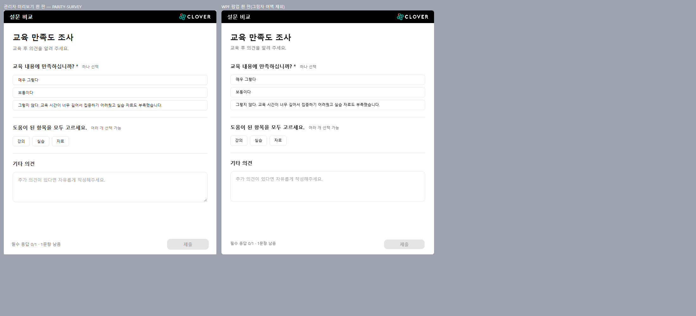
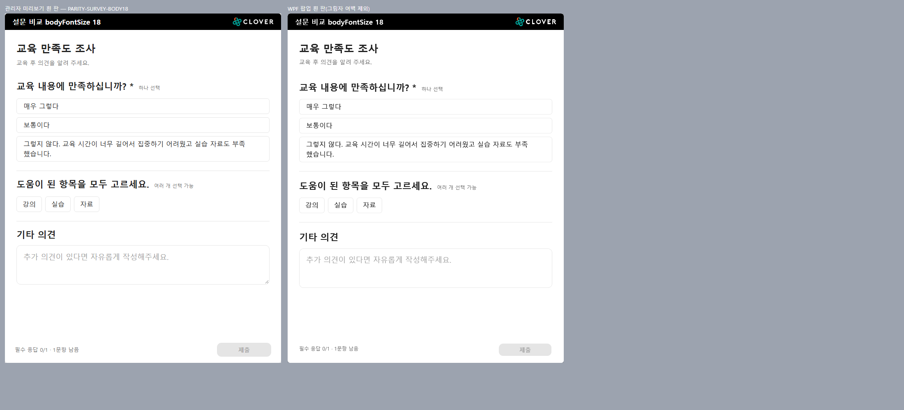
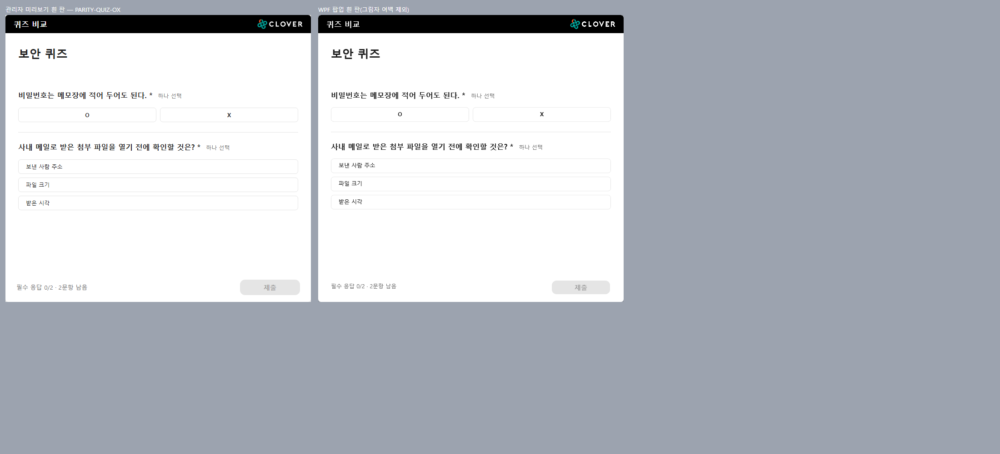
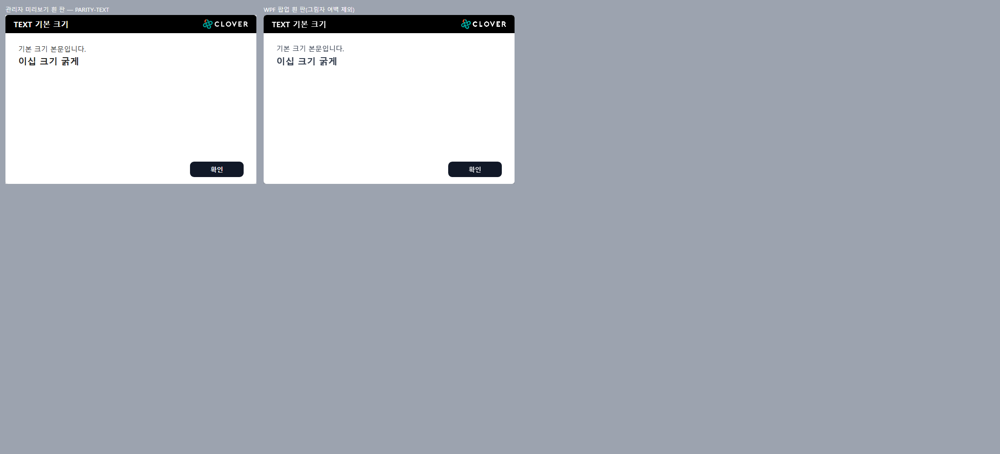
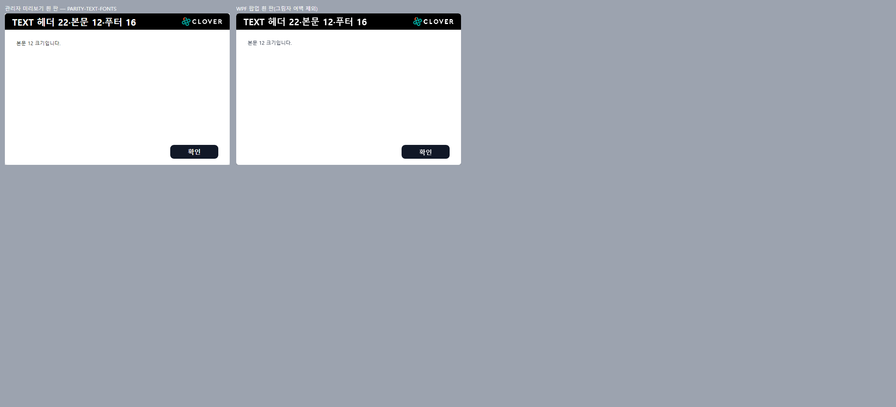
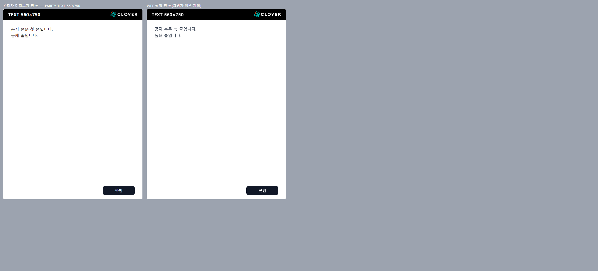
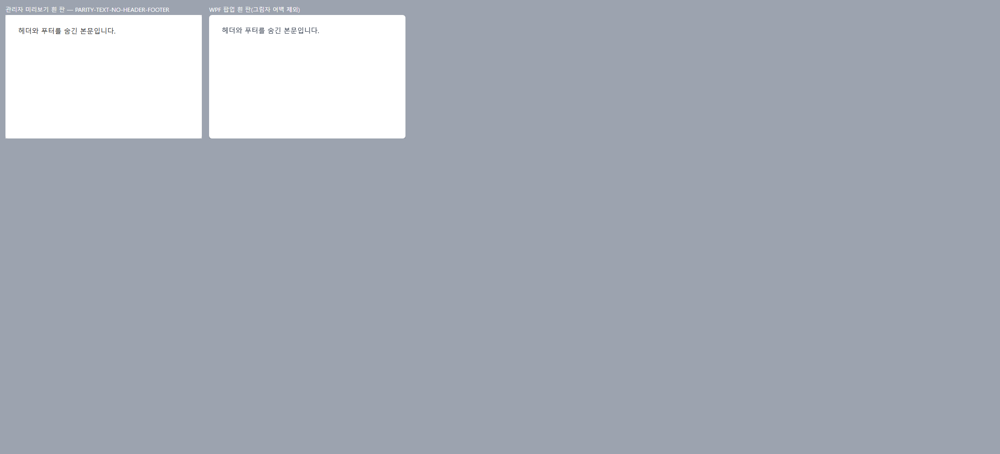
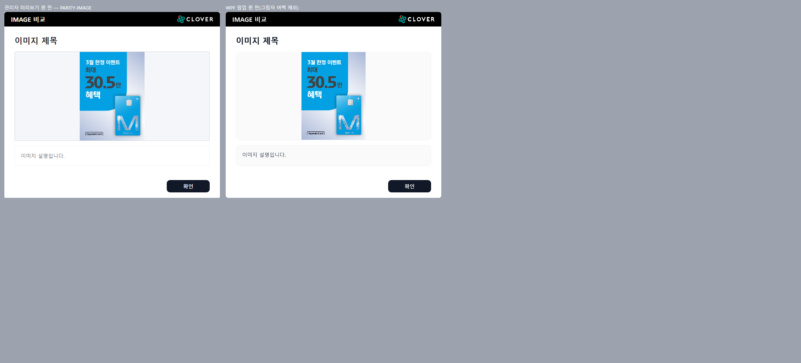
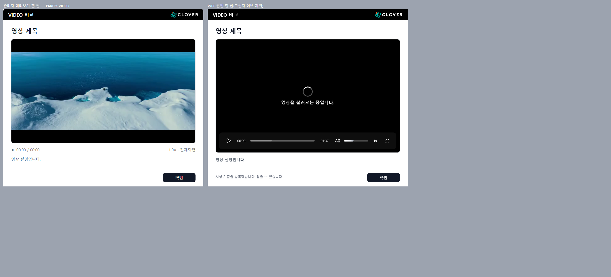
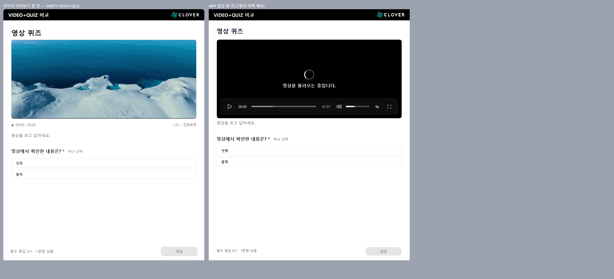

# 웹 미리보기·WPF 글자·영역 실측 (TODO61-20)

생성 2026-11-19T12:34:27.882Z · 웹 headless Edge 100% · WPF RenderTargetBitmap 96 DPI · 좌표는 흰 판 왼쪽 위 기준(px = DIP)

요약: 대조 글자 71건, 크기·굵기 차이 8건(⚠), WPF에서 같은 글자를 찾지 못한 웹 글자 11건.

## PARITY-SURVEY (SURVEY 720×820)

| 글자 | 웹 크기/굵기 | WPF 크기/굵기 | 웹 x,y | WPF x,y | 웹 패밀리 | WPF 패밀리 |
|---|---|---|---|---|---|---|
| 설문 비교 | 17/600 | 17/600 | 18,7.3 | 18,8.7 | Malgun Gothic | 맑은 고딕 |
| 교육 만족도 조사 | 25/800 | 25/600 ⚠ | 28,64 | 28,68 | Malgun Gothic | 맑은 고딕 |
| 교육 후 의견을 알려 주세요. | 14/400 | 14/400 | 28,109.3 | 28,109.3 | Malgun Gothic | 맑은 고딕 |
| 교육 내용에 만족하십니까? *하나 선택 | 16/600 | — | 28,165.3 | — | Malgun Gothic | — |
| 하나 선택 | 12/400 | 12/400 | 247.4,170.3 | 28,165.3 | Malgun Gothic | 맑은 고딕 |
| 매우 그렇다 | 12/400 | 12/400 | 45,211.3 | 45,210.3 | Malgun Gothic | 맑은 고딕 |
| 보통이다 | 12/400 | 12/400 | 45,251.3 | 45,250.3 | Malgun Gothic | 맑은 고딕 |
| 그렇지 않다. 교육 시간이 너무 길어서 집중 | 12/400 | 12/400 | 45,291.3 | 45,290.3 | Malgun Gothic | 맑은 고딕 |
| 도움이 된 항목을 모두 고르세요.여러 개 선 | 16/600 | — | 28,359.3 | — | Malgun Gothic | — |
| 여러 개 선택 가능 | 12/400 | 12/400 | 274.7,364.3 | 28,358.3 | Malgun Gothic | 맑은 고딕 |
| 강의 | 12/400 | 12/400 | 43,405.3 | 43,403.3 | Malgun Gothic | 맑은 고딕 |
| 실습 | 12/400 | 12/400 | 105,405.3 | 105,403.3 | Malgun Gothic | 맑은 고딕 |
| 자료 | 12/400 | 12/400 | 167,405.3 | 167,403.3 | Malgun Gothic | 맑은 고딕 |
| 기타 의견 | 16/600 | 16/600 | 28,473.3 | 28,471.3 | Malgun Gothic | 맑은 고딕 |
| 필수 응답 0/1 · 1문항 남음 | 13/400 | 12/400 ⚠ | 24,730.3 | 28,729 | Malgun Gothic | 맑은 고딕 |
| 제출 | 14/600 | 14/600 | 516,723 | 564,730.7 | Malgun Gothic | 맑은 고딕 |

WPF에만 있는 글자: `교육 내용에 만족하십니까? *`, `교육 내용에 만족하십니까? *`, `도움이 된 항목을 모두 고르세요.`, `도움이 된 항목을 모두 고르세요.`, `추가 의견이 있다면 자유롭게 작성해주`

| 영역 | 웹 | WPF |
|---|---|---|
| 헤더 높이 | 40 | 40 |
| 주 버튼(제출) 크기 | 132×34 | 132×34 |
| 주 버튼 아래~흰 판 아래 | 15 | 15 |

## PARITY-SURVEY-BODY18 (SURVEY 720×900)

| 글자 | 웹 크기/굵기 | WPF 크기/굵기 | 웹 x,y | WPF x,y | 웹 패밀리 | WPF 패밀리 |
|---|---|---|---|---|---|---|
| 설문 비교 bodyFontSize 18 | 17/600 | 17/600 | 18,7.3 | 18,8.7 | Malgun Gothic | 맑은 고딕 |
| 교육 만족도 조사 | 25/800 | 25/600 ⚠ | 28,64 | 28,68 | Malgun Gothic | 맑은 고딕 |
| 교육 후 의견을 알려 주세요. | 14/400 | 14/400 | 28,109.3 | 28,109.3 | Malgun Gothic | 맑은 고딕 |
| 교육 내용에 만족하십니까? *하나 선택 | 22/600 | — | 28,165.3 | — | Malgun Gothic | — |
| 하나 선택 | 12/400 | 12/400 | 325.2,173.3 | 28,165.3 | Malgun Gothic | 맑은 고딕 |
| 매우 그렇다 | 16/400 | 16/400 | 45,214.3 | 45,215.5 | Malgun Gothic | 맑은 고딕 |
| 보통이다 | 16/400 | 16/400 | 45,260.3 | 45,261.5 | Malgun Gothic | 맑은 고딕 |
| 그렇지 않다. 교육 시간이 너무 길어서 집중 | 16/400 | 16/400 | 45,306.3 | 45,307.5 | Malgun Gothic | 맑은 고딕 |
| 도움이 된 항목을 모두 고르세요.여러 개 선 | 22/600 | — | 28,404.3 | — | Malgun Gothic | — |
| 여러 개 선택 가능 | 12/400 | 12/400 | 362.7,412.3 | 28,405.5 | Malgun Gothic | 맑은 고딕 |
| 강의 | 16/400 | 16/400 | 43,453.3 | 43,455.8 | Malgun Gothic | 맑은 고딕 |
| 실습 | 16/400 | 16/400 | 113,453.3 | 113,455.8 | Malgun Gothic | 맑은 고딕 |
| 자료 | 16/400 | 16/400 | 183,453.3 | 183,455.8 | Malgun Gothic | 맑은 고딕 |
| 기타 의견 | 22/600 | 22/600 | 28,527.3 | 28,529.8 | Malgun Gothic | 맑은 고딕 |
| 필수 응답 0/1 · 1문항 남음 | 13/400 | 12/400 ⚠ | 24,810.3 | 28,809 | Malgun Gothic | 맑은 고딕 |
| 제출 | 14/600 | 14/600 | 516,803 | 564,810.7 | Malgun Gothic | 맑은 고딕 |

WPF에만 있는 글자: `교육 내용에 만족하십니까? *`, `교육 내용에 만족하십니까? *`, `도움이 된 항목을 모두 고르세요.`, `도움이 된 항목을 모두 고르세요.`, `추가 의견이 있다면 자유롭게 작성해주`

| 영역 | 웹 | WPF |
|---|---|---|
| 헤더 높이 | 40 | 40 |
| 주 버튼(제출) 크기 | 132×34 | 132×34 |
| 주 버튼 아래~흰 판 아래 | 15 | 15 |

## PARITY-QUIZ-OX (QUIZ 720×680)

| 글자 | 웹 크기/굵기 | WPF 크기/굵기 | 웹 x,y | WPF x,y | 웹 패밀리 | WPF 패밀리 |
|---|---|---|---|---|---|---|
| 퀴즈 비교 | 17/600 | 17/600 | 18,7.3 | 18,8.7 | Malgun Gothic | 맑은 고딕 |
| 보안 퀴즈 | 25/800 | 25/600 ⚠ | 28,64 | 28,68 | Malgun Gothic | 맑은 고딕 |
| 비밀번호는 메모장에 적어 두어도 된다. *하 | 16/600 | — | 28,165.3 | — | Malgun Gothic | — |
| 하나 선택 | 12/400 | 12/400 | 335.6,170.3 | 28,165.3 | Malgun Gothic | 맑은 고딕 |
| O | 12/700 | 12/700 | 43,211.3 | 43,210.3 | Malgun Gothic | 맑은 고딕 |
| X | 12/700 | 12/700 | 355,211.3 | 355,210.3 | Malgun Gothic | 맑은 고딕 |
| 사내 메일로 받은 첨부 파일을 열기 전에 확 | 16/600 | — | 28,279.3 | — | Malgun Gothic | — |
| 하나 선택 | 12/400 | 12/400 | 441.2,284.3 | 28,278.3 | Malgun Gothic | 맑은 고딕 |
| 보낸 사람 주소 | 12/400 | 12/400 | 45,325.3 | 45,323.3 | Malgun Gothic | 맑은 고딕 |
| 파일 크기 | 12/400 | 12/400 | 45,365.3 | 45,363.3 | Malgun Gothic | 맑은 고딕 |
| 받은 시각 | 12/400 | 12/400 | 45,405.3 | 45,403.3 | Malgun Gothic | 맑은 고딕 |
| 필수 응답 0/2 · 2문항 남음 | 13/400 | 12/400 ⚠ | 24,590.3 | 28,589 | Malgun Gothic | 맑은 고딕 |
| 제출 | 14/600 | 14/600 | 516,583 | 564,590.7 | Malgun Gothic | 맑은 고딕 |

WPF에만 있는 글자: `비밀번호는 메모장에 적어 두어도 된다`, `비밀번호는 메모장에 적어 두어도 된다`, `사내 메일로 받은 첨부 파일을 열기 `, `사내 메일로 받은 첨부 파일을 열기 `

| 영역 | 웹 | WPF |
|---|---|---|
| 헤더 높이 | 40 | 40 |
| 주 버튼(제출) 크기 | 132×34 | 132×34 |
| 주 버튼 아래~흰 판 아래 | 15 | 15 |

## PARITY-TEXT (TEXT 600×420)

| 글자 | 웹 크기/굵기 | WPF 크기/굵기 | 웹 x,y | WPF x,y | 웹 패밀리 | WPF 패밀리 |
|---|---|---|---|---|---|---|
| TEXT 기본 크기 | 17/600 | 17/600 | 18,7.3 | 18,8.7 | Malgun Gothic | 맑은 고딕 |
| 기본 크기 본문입니다. | 15/400 | 15/400 | 28,65 | 28,64 | Malgun Gothic | 맑은 고딕 |
| 이십 크기 굵게 | 20/700 | 20/700 | 28,87.5 | 28,88 | Malgun Gothic | 맑은 고딕 |
| 확인 | 14/600 | 14/600 | 406,323 | 451,330.7 | Malgun Gothic | 맑은 고딕 |

| 영역 | 웹 | WPF |
|---|---|---|
| 헤더 높이 | 40 | 40 |
| 주 버튼(확인) 크기 | 118×34 | 118×34 |
| 주 버튼 아래~흰 판 아래 | 15 | 15 |

## PARITY-TEXT-FONTS (TEXT 600×420)

| 글자 | 웹 크기/굵기 | WPF 크기/굵기 | 웹 x,y | WPF x,y | 웹 패밀리 | WPF 패밀리 |
|---|---|---|---|---|---|---|
| TEXT 헤더 22·본문 12·푸터 16 | 22/600 | 22/600 | 18,3.5 | 18,5.4 | Malgun Gothic | 맑은 고딕 |
| 본문 12 크기입니다. | 12/400 | 12/400 | 28,65 | 28,64 | Malgun Gothic | 맑은 고딕 |
| 확인 | 16/600 | 16/600 | 406,323 | 449,329.4 | Malgun Gothic | 맑은 고딕 |

| 영역 | 웹 | WPF |
|---|---|---|
| 헤더 높이 | 40 | 40 |
| 주 버튼(확인) 크기 | 118×34 | 118×34 |
| 주 버튼 아래~흰 판 아래 | 15 | 15 |

## PARITY-TEXT-560x750 (TEXT 560×750)

| 글자 | 웹 크기/굵기 | WPF 크기/굵기 | 웹 x,y | WPF x,y | 웹 패밀리 | WPF 패밀리 |
|---|---|---|---|---|---|---|
| TEXT 560×750 | 17/600 | 17/600 | 18,7.3 | 18,8.7 | Malgun Gothic | 맑은 고딕 |
| 공지 본문 첫 줄입니다. 둘째 줄입니다. | 15/400 | 15/400 | 28,64 | 28,64 | Malgun Gothic | 맑은 고딕 |
| 확인 | 14/600 | 14/600 | 366,653 | 411,660.7 | Malgun Gothic | 맑은 고딕 |

| 영역 | 웹 | WPF |
|---|---|---|
| 헤더 높이 | 40 | 40 |
| 주 버튼(확인) 크기 | 118×34 | 118×34 |
| 주 버튼 아래~흰 판 아래 | 15 | 15 |

## PARITY-TEXT-NARROW-LONG (TEXT 360×480)

| 글자 | 웹 크기/굵기 | WPF 크기/굵기 | 웹 x,y | WPF x,y | 웹 패밀리 | WPF 패밀리 |
|---|---|---|---|---|---|---|
| 좁은 폭에서 아주 긴 팝업 제목이 한 줄 말 | 17/600 | 17/600 | 18,7.3 | 18,8.7 | Malgun Gothic | 맑은 고딕 |
| 긴 문구 줄바꿈 확인용 본문입니다. 좁은 창 | 15/400 | 15/400 | 28,64 | 28,64 | Malgun Gothic | 맑은 고딕 |
| 나중에 보기 | 14/600 | 14/600 | 28,337 | 51,390.7 | Malgun Gothic | 맑은 고딕 |
| 30일간 보지 않기 | 14/400 | 14/400 | 198.9,333 | 202.9,390.7 | Malgun Gothic | 맑은 고딕 |
| 확인 | 14/600 | 14/600 | 166,383 | 211,390.7 | Malgun Gothic | 맑은 고딕 |

| 영역 | 웹 | WPF |
|---|---|---|
| 헤더 높이 | 40 | 40 |
| 주 버튼(확인) 크기 | 118×34 | 118×34 |
| 주 버튼 아래~흰 판 아래 | 15 | 15 |

## PARITY-TEXT-NO-HEADER-FOOTER (TEXT 480×320)

| 글자 | 웹 크기/굵기 | WPF 크기/굵기 | 웹 x,y | WPF x,y | 웹 패밀리 | WPF 패밀리 |
|---|---|---|---|---|---|---|
| 헤더와 푸터를 숨긴 본문입니다. | 15/400 | 15/400 | 28,24 | 28,24 | Malgun Gothic | 맑은 고딕 |

| 영역 | 웹 | WPF |
|---|---|---|
| 헤더 높이 | 숨김 | 숨김 |
| 주 버튼(없음) 크기 | — | — |
| 주 버튼 아래~흰 판 아래 | — | — |

## PARITY-IMAGE (IMAGE 640×560)

| 글자 | 웹 크기/굵기 | WPF 크기/굵기 | 웹 x,y | WPF x,y | 웹 패밀리 | WPF 패밀리 |
|---|---|---|---|---|---|---|
| IMAGE 비교 | 17/600 | 17/600 | 18,7.3 | 18,8.7 | Malgun Gothic | 맑은 고딕 |
| 이미지 제목 | 22/600 | 22/600 | 28,64 | 28,64 | Malgun Gothic | 맑은 고딕 |
| 이미지 설명입니다. | 14/400 | 14/400 | 45,386 | 45,384 | Malgun Gothic | 맑은 고딕 |
| 확인 | 14/600 | 14/600 | 446,463 | 491,470.7 | Malgun Gothic | 맑은 고딕 |

| 영역 | 웹 | WPF |
|---|---|---|
| 헤더 높이 | 40 | 40 |
| 주 버튼(확인) 크기 | 118×34 | 118×34 |
| 주 버튼 아래~흰 판 아래 | 15 | 15 |

## PARITY-VIDEO (VIDEO 720×640)

| 글자 | 웹 크기/굵기 | WPF 크기/굵기 | 웹 x,y | WPF x,y | 웹 패밀리 | WPF 패밀리 |
|---|---|---|---|---|---|---|
| VIDEO 비교 | 17/600 | 17/600 | 18,7.3 | 18,8.7 | Malgun Gothic | 맑은 고딕 |
| 영상 제목 | 22/600 | 22/600 | 28,64 | 28,64 | Malgun Gothic | 맑은 고딕 |
| ▶ 00:00 / 00:00 | 14/400 | — | 28,495.8 | — | Malgun Gothic | — |
| 1.0× · 전체화면 | 14/400 | — | 594.8,495.8 | — | Malgun Gothic | — |
| 영상 설명입니다. | 14/400 | 14/400 | 28,531 | 28,533.4 | Malgun Gothic | 맑은 고딕 |
| 확인 | 14/600 | 14/600 | 574,591 | 619,598.7 | Malgun Gothic | 맑은 고딕 |

WPF에만 있는 글자: ``, `00:00`, `01:37`, ``, `1x`, `⛶`, `영상을 불러오는 중입니다.`, `시청 기준을 충족했습니다. 닫을 수 `

| 영역 | 웹 | WPF |
|---|---|---|
| 헤더 높이 | 40 | 40 |
| 주 버튼(확인) 크기 | 118×34 | 118×34 |
| 주 버튼 아래~흰 판 아래 | 15 | 15 |

## PARITY-VIDEO-QUIZ (QUIZ+VIDEO 720×900)

| 글자 | 웹 크기/굵기 | WPF 크기/굵기 | 웹 x,y | WPF x,y | 웹 패밀리 | WPF 패밀리 |
|---|---|---|---|---|---|---|
| VIDEO+QUIZ 비교 | 17/600 | 17/600 | 18,7.3 | 18,8.7 | Malgun Gothic | 맑은 고딕 |
| 영상 퀴즈 | 25/800 | 22/600 ⚠ | 28,64 | 28,64 | Malgun Gothic | 맑은 고딕 |
| ▶ 00:00 / 00:00 | 12/400 | — | 28,404.7 | — | Malgun Gothic | — |
| 1.0× · 전체화면 | 12/400 | — | 608.7,404.7 | — | Malgun Gothic | — |
| 영상을 보고 답하세요. | 14/400 | 14/400 | 28,440.6 | 28,397.6 | Malgun Gothic | 맑은 고딕 |
| 영상에서 확인한 내용은? *하나 선택 | 16/600 | — | 28,496.6 | — | Malgun Gothic | — |
| 하나 선택 | 12/400 | 12/400 | 231.4,501.6 | 28,453.6 | Malgun Gothic | 맑은 고딕 |
| 첫째 | 12/400 | 12/400 | 45,542.6 | 45,498.6 | Malgun Gothic | 맑은 고딕 |
| 둘째 | 12/400 | 12/400 | 45,582.6 | 45,538.6 | Malgun Gothic | 맑은 고딕 |
| 필수 응답 0/1 · 1문항 남음 | 13/400 | 12/400 ⚠ | 24,858.3 | 28,857 | Malgun Gothic | 맑은 고딕 |
| 제출 | 14/600 | 14/600 | 564,851 | 612,858.7 | Malgun Gothic | 맑은 고딕 |

WPF에만 있는 글자: ``, `00:00`, `01:37`, ``, `1x`, `⛶`, `영상을 불러오는 중입니다.`, `영상에서 확인한 내용은? *`, `영상에서 확인한 내용은? *`

| 영역 | 웹 | WPF |
|---|---|---|
| 헤더 높이 | 40 | 40 |
| 주 버튼(제출) 크기 | 132×34 | 132×34 |
| 주 버튼 아래~흰 판 아래 | 15 | 15 |

